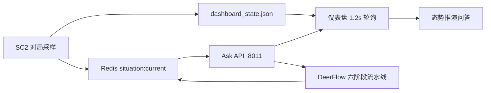

# 星际争霸游戏辅助决策系统 — 演示演讲稿

> **建议时长**：12–18 分钟（含 1 次「刷新分析」等待）  
> **演示入口**：`http://127.0.0.1:8000/dashboard/`  
> **前置条件**：对局采样（`swarmbrain_launch.py`）+ Ask API（`launch_ask_stack.ps1`）已启动

---

## 一、开场（约 1 分钟）

各位好。

今天展示的是 **「星际争霸游戏辅助决策系统」**。

它不是单纯的观战面板，而是一套面向实时对抗的 **「感知 → 研判 → 决策 → 执行」闭环**：左侧始终锚定 **战场态势沙盘** 与 **自然语言问询**；右侧是 **态势分析系统**，按业务链路逐层展开从事实到方案的全流程。

页眉会实时显示对局状态——**运行中 / 空闲**，以及 **前期 / 中期 / 后期** 阶段标签，让听众始终知道当前看到的是「真对局」还是「待机预览」。

---

## 二、整体布局：双栏 + 态势分析（约 1 分钟）

请先看整体信息架构。

界面采用 **「左固定、右可深潜」** 的布局：

| 区域 | 模块 | 作用 |
|------|------|------|
| **左侧上** | 战场态势沙盘 | 全局空间锚点：迷雾、矿区、单位、射程圈 |
| **左侧下** | 态势推演问答 | 自然语言问询，结合当前态势给建议 |
| **右侧** | 态势分析系统 | 七个业务模块 Tab，与沙盘联动高亮 |

页脚会显示 **约 1.2 秒轮询间隔** 与连接状态——数据来自对局进程写入的 `dashboard_state.json`，保证盘面与后台同步。

**展示逻辑要点**：系统有「冷启动保护」——仅打开静态服务时，沙盘只显示底图预览，不渲染过期对局数据；对局指纹变化后，界面才 **武装（liveUiArmed）** 并展示完整态势。这样避免「没开游戏却看到上一场」的误导。

---

## 三、系统总览：业务架构图（约 2 分钟）

请先点击右侧 **「系统总览」**，进入 **业务架构** 画布。

架构分为上下两条带：

### 3.1 智能决策与控制（在线能力）

这是本次演示的核心链路，包含四块能力节点，卡片上的按钮可直接跳转到对应 Skill 页面：

1. **全局态势感知与态势计算**  
   - 融合战争迷雾、经济与兵力拓扑，构建完备战场信息  
   - 入口：**态势感知**、**兵力布势**

2. **意图推理与态势研判**  
   - 将态势编排为多阶段子智能体流水线  
   - 产出路径：**事实 → 量化 → 布势 → 意图 → 风险 → 处置**  
   - 入口：**意图识别**、**风险分析**、**杀伤链**、**关键节点**

3. **战术指令解析与执行**  
   - 总线协同、任务划分、单元指定、指令解析闭环  
   - 入口：**任务生成**（作战方案生成）

4. **多阶段战术分解**  
   - 宏观战略意图拆解为多阶段子任务，由规划智能体下发至作战单元

画布上的 **动态连线** 表达数据与知识流向：输入态势 → 宏观研判 → 战术分解 → 执行反馈。

### 3.2 知识库构建（策略迭代）

下方是 **战术战法库** 与 **战术战法评估**，通过 **「评估结论回流、沉淀至战法库」** 形成闭环更新机制——对应页角的 **「策略迭代：知识库闭环更新机制」** 标签。

**演讲话术**：  
> 「总览页不是目录，而是产品故事线：上面是实时决策链，下面是经验沉淀链。点击任意 Skill 按钮，会进入全屏模块页，左侧沙盘随模块切换展示不同图层。」

---

## 四、左侧沙盘：空间认知中枢（约 2 分钟）

回到主工作区左侧 **「战场态势沙盘」**。

### 4.1 多层叠加展示

沙盘采用分层渲染：

- **底图**：标准小地图  
- **迷雾层**：体现战争迷雾与可见比例  
- **资源层**：矿区标记  
- **范围圈层**（部分模块开启）：侦察 / 打击 / 防御范围  
- **单元标记层**：敌我单位，按角色着色（打击 / 探测 / 防御 / 保障等）

右侧 **图例** 说明各色标记含义；**沙盘状态** 面板展示帧号、回合、标记数量及视野摘要。

### 4.2 映射调整

若坐标与底图略有偏差，可展开 **「映射调整」**：微调 X/Y 偏移、缩放及底图比例，并支持 **重置默认**——参数会本地持久化，保证多场次演示一致。

**演讲话术**：  
> 「沙盘是所有分析结论的空间落点。后面讲意图、风险、杀伤链时，右侧文字结论都会在左侧『亮起来』，形成图文互证。」

---

## 五、态势推演问答：人机协同入口（约 1.5 分钟）

左下角是 **「态势推演问答」**，副标题为 **态势问询 / 语义检索 / 战术建议**。

### 5.1 交互方式

- 在输入框用自然语言提问，例如：  
  **「敌方主力可能从哪一路进攻？我方应先守还是先扩？」**
- 点击 **「发送提问」**，系统调用 Ask API，优先读取 Redis 中的 `situation:current`，回退到本地态势 JSON。
- 回答以 **Markdown** 渲染；底部展示 **时间戳**、**数据来源**（redis / dashboard_state 等）及 **工具轨迹芯片**（如 `sc2_get_situation`、`llm:chat`），便于追溯结论依据。

### 5.2 与右侧分析的关系

问答是 **「即问即答」** 的灵活入口；右侧 Tab 是 **「结构化流水线」** 的固定产出。二者共享同一份态势底座，适合不同角色：指挥员快速问询，分析员按模块审阅。

---

## 六、态势分析系统：按业务链路演示（约 7–9 分钟）

进入右侧 **态势分析系统**。除总览外，顶栏提供七个模块 Tab；进入任一分析模块后，会打开 **全屏模块页**：左侧放大沙盘，右侧展示该阶段结论，顶部有 **「返回系统总览」** 与 **「刷新分析」**。

> **关键操作**：点击 **「刷新分析」** 后，按钮变为 **「智能体分析中...」**，后台触发 DeerFlow 六阶段流水线，结果写入 Redis 后各模块自动填充。

### 6.1 态势感知（S1 + S2）

**业务场景**：把「看见了什么」变成「算清楚了什么」。

- **S1 态势感知（sc2-sensing）**  
  - 对局时间、地图、迷雾比例、经济与兵力快照等 **事实层**  
  - 部分字段在对局运行时由本地实时读取，不依赖流水线

- **S2 态势计算（sc2-compute）**  
  - 敌我量化对比：兵力、经济、趋势等 **计算层**  
  - 卡片提示：**「点击刷新分析后，会写入 Redis 并在此处渲染」**

**沙盘配置**：展示迷雾、资源与单位，建立战场基线认知。

---

### 6.2 兵力布势

**业务场景**：回答「双方各有什么能力、部署在哪」。

- **能力结构**：按 **打击 / 探测 / 防御 / 保障** 四维对比敌我总量与结构条  
- **部署明细**：单元级布势列表  
- **协同建议**：可触发 LLM 刷新，给出兵力运用建议  

**沙盘配置**：开启范围圈层，突出侦察、打击、防御覆盖。

**演讲话术**：  
> 「布势页把『有多少兵』升级为『有什么能力、覆盖哪里』，为后续意图与风险提供结构化输入。」

---

### 6.3 意图识别

**业务场景**：推断敌方当前主策略与重点角色。

- 展示 **意图维度**、策略类别（经济 / 科技 / 兵力 / 防御等）  
- **沙盘联动**：与意图相关的 **敌方单位高亮**，无关单位弱化（dim），形成「敌人在想什么」的空间表达  

**演讲话术**：  
> 「意图页不仅给文字判断，还通过高亮告诉你看哪几类单位——这是前端把 NLP 结论映射回战场的关键设计。」

---

### 6.4 风险分析

**业务场景**：四维风险识别 + 处置要点。

- 风险分组：**进攻 / 防御 / 探测 / 保障**  
- 每条风险对应 **处置方案** 与要点摘要  
- **沙盘联动**：选中风险组后，相关目标出现 **风险标记环** 与警示样式；非相关单位弱化  

进入意图或风险 Tab 时，若尚无分析线程，系统可 **自动触发刷新分析**，减少空页演示尴尬。

---

### 6.5 杀伤链发现

**业务场景**：识别敌方杀伤链并给出破坏路径。

- **待破坏链路**：按打击 / 探测 / 防御 / 保障分类展示  
- **作战模式** 切换不同敌链组合  
- **敌链破坏步骤流**：步骤序列 + **沙盘 SVG 箭头** 串联节点，把「先打谁、再打谁」画在地图上  

**演讲话术**：  
> 「杀伤链页是可视化最重的一屏——右侧步骤流与左侧箭头一一对应，适合向非技术听众解释『链式打击』。」

---

### 6.6 关键打击节点识别

**业务场景**：从众多目标中筛选高价值节点。

- **关键节点清单**：名称、类型、优先级说明  
- **沙盘联动**：用户 **点击节点** 后，对应敌方单位出现 **瞄准（critical-aim）** 样式——强调「人机确认」而非全自动开火  
- 可请求 **打击目标 LLM 建议**，辅助决策  

---

### 6.7 作战方案生成

**业务场景**：从研判走向可执行指令。

本模块是 **决策闭环** 的终点，通常包含：

1. **方案生成智能体**  
   - 对话式方案产出，支持打字机效果与历史折叠  

2. **任务划分**  
   - 按 **打击 / 探测 / 防御 / 保障** 组织子任务  

3. **单元指定**  
   - 任务与具体作战单元映射  

4. **指令解析**  
   - **待执行 / 已执行** 双队列  
   - 指令分类：进攻、防御、采集、建造、训练、侦察、科技等  
   - 新指令 **闪烁提示**，支持分类 Tab 筛选  

**演讲话术**：  
> 「前面各模块回答『发生了什么、意味着什么』；方案页回答『接下来做什么、谁去做、是否已下发』，形成完整 OODA 环。」

---

## 七、数据与展示逻辑（技术听众附录，约 1 分钟）

若现场有技术同事，可简要说明三条原则：

1. **盘面刷新**：`dashboard_state.json` → 前端 1.2s 轮询 → 沙盘 / HUD / 指令队列  
2. **智能分析**：`刷新分析` → Ask API 拉起流水线 → `sc2-sensing → compute → disposition → intent → risk-id → risk-response` → Redis 阶段 JSON → 各 Tab 渲染  
3. **模块沙盘差异**：每个 Tab 有独立的 `moduleMinimapConfig`（是否显示迷雾、资源、射程圈、单位及高亮规则），实现 **「同一沙盘、不同叙事视角」**

另有一个轻量 **「SwarmBrain 战术监视器」**（`/game-view/`），面向嵌入场景：HUD + 特征图 + 指令队列，与主仪表盘共享同一份状态文件。

---

## 八、推荐演示脚本（操作顺序）

| 步骤 | 操作 | 讲解重点 |
|------|------|----------|
| 1 | 打开仪表盘，指出页眉状态 | 产品定位、对局阶段 |
| 2 | 右侧 → **系统总览** | 业务架构双线、Skill 跳转 |
| 3 | 左侧沙盘 + 图例 | 分层态势、映射调整 |
| 4 | **刷新分析**（等待） | 多智能体流水线、Redis 回写 |
| 5 | **态势感知 → 兵力布势** | 事实→量化→能力四维 |
| 6 | **意图识别 → 风险分析** | 沙盘高亮、四维风险与处置 |
| 7 | **杀伤链 → 关键节点** | 步骤流箭头、点击瞄准 |
| 8 | **作战方案生成** | 任务划分、待执行/已执行指令 |
| 9 | 左下 **态势推演问答** 提 1 个问题 | 灵活问询、来源与 traces |
| 10 | 页脚轮询与返回总览 | 实时性、可扩展架构 |

---

## 九、收尾（约 1 分钟）

总结一下，本系统的价值体现在三点：

1. **一张沙盘贯穿全流程**——从感知到方案，结论都能落回空间坐标；  
2. **一条流水线承载专业研判**——六阶段智能体把经验型指挥过程产品化、可复盘；  
3. **两种交互服务不同角色**——结构化 Tab 适合体系化审阅，问答适合临场决断。

未来，下方 **知识库构建** 带将把每一场对抗沉淀为战法与评估，形成 **「打得越多、判得越准」** 的策略迭代闭环。

我的演示到此结束，谢谢大家。欢迎提问。

---

## 附录：模块与界面文案对照

| 模块 key | 界面名称 | 核心产出 |
|----------|----------|----------|
| `overview` | 系统总览 | 业务架构、Skill 导航 |
| `awareness` | 态势感知 | S1 感知 + S2 计算 |
| `force` | 兵力布势 | 四维能力 + 部署 + 协同建议 |
| `intent` | 意图识别 | 意图维度 + 敌单位高亮 |
| `risk` | 风险分析 | 四维风险 + 处置 + 风险标记 |
| `killchain` | 杀伤链发现 | 敌链 + 破坏步骤流 + 箭头 |
| `critical` | 关键打击节点识别 | 节点清单 + 瞄准确认 |
| `plan` | 作战方案生成 | 方案对话 + 任务 + 指令闭环 |
