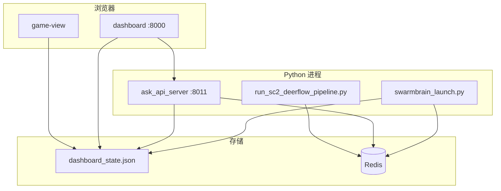

# SwarmBrain 星际争霸辅助决策系统 — 部署文档

本文档面向**全新 Windows 机器**，按步骤操作即可完整部署本压缩包内的工程（含对局、仪表盘、问答 API、DeerFlow 六阶段分析）。

---

## 1. 部署包内容说明

解压后得到 `SwarmBrain_deploy_<时间戳>/` 目录，主要包含：

| 类别 | 路径/文件 | 说明 |
|------|-----------|------|
| 对局主程序 | `swarmbrain_launch.py`、`swarmbrain.py` | SC2 对局 + 态势写盘 |
| 仪表盘 | `dashboard/`、`game-view/`、`serve_dashboard.py` | Vue 前端 + 静态服务 |
| 问答与分析 | `ask_api_server.py`、`launch_support_stack.py`、`launch_ask_stack.ps1` | Ask API + Redis |
| 流水线 | `run_sc2_deerflow_pipeline.py`、`sc2_agents.py`、`deerflow/` | 六阶段智能体 |
| Redis 工具 | `sc2_redis_tools.py`、`dashboard_to_redis_bridge.py`、`docker-compose.yml` | 态势缓存 |
| MCP（可选） | `mcp_server/sc2_mcp_server.py` | Cursor/外部 MCP 联调 |
| 依赖 | `requirements.txt` | Python 包清单 |
| **私密配置** | **`.env`** | **已含 API Key、SC2 路径等，部署后务必按新机修改** |
| 配置模板 | `.env.example` | 字段说明参考 |
| 启动脚本 | `run_swarmbrain.ps1`、`launch_ask_stack.ps1`、`ask_quick.ps1`、`test_ask_api.ps1` | PowerShell 快捷启动 |
| 说明 | `README.md`、`swarmbrain启动指令.txt`、`分发说明.txt` | 简要指引 |
| 文档 | `docs/部署文档.md`（本文）、`docs/演示演讲稿.md` | 部署与演示 |

**未包含（需在新机自行安装）：**

- Python 虚拟环境 `.venv`（体积大，需 `pip install`）
- 星际争霸 II 游戏本体
- Docker Desktop（若使用容器 Redis）

---

## 2. 环境要求

### 2.1 硬件与系统

- **操作系统**：Windows 10/11（64 位）
- **内存**：建议 ≥ 16 GB（SC2 + LLM 调用 + 浏览器仪表盘）
- **磁盘**：SC2 本体约 50 GB；本项目解压后约数十 MB

### 2.2 必装软件

| 软件 | 版本建议 | 用途 |
|------|----------|------|
| Python | 3.10 / 3.11 / 3.12（64 位） | 运行全部后端 |
| 星际争霸 II | 最新（经 Battle.net 更新） | 对局环境 |
| StarCraft II 地图 | **AutomatonLE**（Ladder 2019 Season 1） | `swarmbrain_launch.py` 固定地图 |

地图安装：从 [Blizzard/s2client-proto](https://github.com/Blizzard/s2client-proto#downloads) 下载后，解压到：

```text
<SC2PATH>\Maps\
```

例如：`D:\StarCraft II\Maps\`（具体以本机 `SC2PATH` 为准）。

### 2.3 可选软件

| 软件 | 用途 |
|------|------|
| Docker Desktop | `launch_ask_stack.ps1` 自动拉起 Redis 容器 |
| Git | 非必须，仅便于后续升级代码 |

---

## 3. 解压与目录约定

1. 将 `docs/SwarmBrain_deploy_*.zip` 解压到目标盘，例如：

   ```text
   D:\Apps\SwarmBrain\
   ```

2. 路径中**避免中文空格过多**；若遇权限问题，不要放在 `C:\Program Files\` 下。

3. 打开 PowerShell，进入解压目录：

   ```powershell
   Set-ExecutionPolicy -Scope Process -ExecutionPolicy Bypass
   cd D:\Apps\SwarmBrain
   ```

---

## 4. 配置私密信息（`.env`）

压缩包内已附带 **`.env`**（含 LLM API Key、SC2 路径等）。**在新机器上必须核对并修改：**

```ini
# 必填：大模型 Key（DashScope OpenAI 兼容或自建网关）
SWARMBRAIN_LLM_API_KEY=<你的 Key>

# 模型与接口（默认千问 DashScope，可按需改）
SWARMBRAIN_LLM_MODEL=qwen3-max
SWARMBRAIN_LLM_BASE_URL=https://dashscope.aliyuncs.com/compatible-mode/v1
SWARMBRAIN_LLM_TEMPERATURE=0.35

# 星际争霸 II 安装路径（必改为本机路径）
SC2PATH=D:\StarCraft II
SWARMBRAIN_SC2PATH=D:\StarCraft II

# 仪表盘内嵌页（一般无需改）
SWARMBRAIN_GAME_EMBED_URL=/game-view/

# 无 Key 或 LLM 失败时是否允许关键词兜底（1=启用）
SWARMBRAIN_ASK_HEURISTIC=1
```

也可不编辑文件，而在每次启动前在 PowerShell 中设置：

```powershell
$env:SC2PATH = "D:\StarCraft II"
$env:SWARMBRAIN_LLM_API_KEY = "你的 Key"
```

> **安全提示**：`.env` 含真实密钥，请勿上传到公开仓库或网盘公开链接。

---

## 5. 首次安装 Python 依赖

在项目根目录执行（仅需一次）：

```powershell
Set-ExecutionPolicy -Scope Process -ExecutionPolicy Bypass
cd <项目根目录>

python -m venv .venv
.\.venv\Scripts\Activate.ps1
python -m pip install -U pip
pip install -r requirements.txt
```

若 PyPI 较慢，可使用清华镜像：

```powershell
pip install -r requirements.txt -i https://pypi.tuna.tsinghua.edu.cn/simple
```

安装完成后，终端提示符前应出现 `(.venv)`。

---

## 6. 启动方式（按使用场景选择）

### 6.1 场景 A：仅运行对局 + 本地仪表盘

**终端 1 — 对局**

```powershell
.\.venv\Scripts\Activate.ps1
# 若未配置 .env，请设置 SC2PATH 与 Key
.\run_swarmbrain.ps1
# 或：python swarmbrain_launch.py
```

**终端 2 — 仪表盘（可选）**

```powershell
.\.venv\Scripts\Activate.ps1
python serve_dashboard.py
```

浏览器打开：**http://127.0.0.1:8000/dashboard/**

战术监视器：**http://127.0.0.1:8000/game-view/**

对局运行后，根目录会刷新 `dashboard_state.json`，前端约 **1.2 秒**轮询一次。

---

### 6.2 场景 B：完整栈（推荐 — 问答 + DeerFlow + 仪表盘）

需要 **3～4 个 PowerShell 终端**，且每个终端先 `Activate.ps1`。

| 顺序 | 终端 | 命令 | 作用 |
|------|------|------|------|
| 1 | A | `.\launch_ask_stack.ps1` | Docker Redis + Ask API `:8011` |
| 2 | B | `.\run_swarmbrain.ps1` | SC2 对局 + Redis 态势同步 |
| 3 | C | `python run_sc2_deerflow_pipeline.py` | DeerFlow 六阶段（可按需手动跑） |
| 4 | D | `python serve_dashboard.py` | 网页仪表盘 |

**已有本机 Redis（6379）时：**

```powershell
.\launch_ask_stack.ps1 --skip-docker
```

**DeerFlow 指定线程 ID（便于复查 Redis 缓存）：**

```powershell
python run_sc2_deerflow_pipeline.py --thread-id my-run-1
```

仪表盘内点击 **「刷新分析」** 也会通过 Ask API 触发流水线，无需单独开终端 C。

---

### 6.3 场景 C：仅验证问答 API

```powershell
.\.venv\Scripts\Activate.ps1
.\launch_ask_stack.ps1
.\test_ask_api.ps1 -Question "敌方主力在哪？"
# 或
.\ask_quick.ps1 -Question "我方应先守还是先扩？"
```

> 中文提问请用上述脚本，避免 `Invoke-RestMethod` 乱码。

健康检查：**http://127.0.0.1:8011/health**

---

### 6.4 场景 D：MCP 服务（Cursor 联调）

```powershell
.\.venv\Scripts\Activate.ps1
python mcp_server/sc2_mcp_server.py
```

需先启动对局或保证 Redis / `dashboard_state.json` 有态势数据。

---

## 7. 端口与服务一览

| 服务 | 默认地址 | 说明 |
|------|----------|------|
| 仪表盘 HTTP | `http://127.0.0.1:8000/dashboard/` | `serve_dashboard.py` |
| Ask API | `http://127.0.0.1:8011` | `launch_ask_stack.ps1` |
| Redis | `127.0.0.1:6379` | Docker 或本机已有实例 |
| SC2 游戏 | — | 由 `swarmbrain_launch` 拉起 |

修改 Ask 端口示例：

```powershell
python launch_support_stack.py --ask-port 8012
```

---

## 8. 部署验收清单

按顺序自检，全部通过即部署成功：

- [ ] `python --version` 为 3.10–3.12
- [ ] `.venv` 已创建且 `pip install -r requirements.txt` 无报错
- [ ] `.env` 中 `SC2PATH` 指向本机 SC2 安装目录且存在 `Maps`
- [ ] `SWARMBRAIN_LLM_API_KEY` 已填写（或环境变量已设置）
- [ ] `.\launch_ask_stack.ps1` 后访问 `http://127.0.0.1:8011/health` 返回正常
- [ ] `python swarmbrain_launch.py` 能进入 AutomatonLE 对局
- [ ] `dashboard_state.json` 随对局更新（修改时间变化）
- [ ] `python serve_dashboard.py` 后仪表盘页眉显示「运行中」
- [ ] 仪表盘「刷新分析」后意图/风险等 Tab 有数据（需 Ask API + 对局态势）
- [ ] `.\ask_quick.ps1 -Question "测试"` 能返回中文回答

---

## 9. 常见问题

### 9.1 `Failed to bind http://127.0.0.1:8000`

8000 端口被占用。结束占用进程或修改 `serve_dashboard.py` 的 `--port`。

### 9.2 Docker / Redis 连接失败

- 确认 Docker Desktop 已启动；或改用 `.\launch_ask_stack.ps1 --skip-docker` 并保证本机 Redis 在 6379 监听。
- 仅开仪表盘、不开 Ask 时，可只跑对局 + `serve_dashboard.py`（部分智能分析 Tab 为空）。

### 9.3 仪表盘只有底图、无单位

- 未启动 `swarmbrain_launch.py`，或 `dashboard_state.json` 为旧数据；冷启动保护会只显示底图预览。
- 先启动对局，待状态文件指纹变化后再刷新浏览器。

### 9.4 SC2 找不到地图或路径

- 检查 `SC2PATH` / `SWARMBRAIN_SC2PATH`。
- 确认 `Maps` 下存在 **AutomatonLE**。

### 9.5 LLM 无响应或仅规则兜底

- 检查 `.env` 中 `SWARMBRAIN_LLM_API_KEY` 是否有效、余额与网络是否正常。
- 访问 `/health` 查看 Key 是否被识别。

### 9.6 `pip install burnysc2` 失败

使用 64 位 Python；必要时升级 pip 并用国内镜像重试。

---

## 10. 目录与进程关系（架构简图）



---

## 11. 升级与重新打包

若从源码仓库更新后需重新生成部署 zip，在**原开发机**项目根目录执行：

```powershell
.\package_release.ps1
```

新包输出在 `docs/SwarmBrain_deploy_<时间戳>.zip`。打包前请确认 `.env` 中为**目标部署环境**可用的 Key 与路径。

---

## 12. 快速命令索引

```powershell
# 环境
python -m venv .venv
.\.venv\Scripts\Activate.ps1
pip install -r requirements.txt

# 全栈
.\launch_ask_stack.ps1
.\run_swarmbrain.ps1
python serve_dashboard.py

# 问答
.\ask_quick.ps1 -Question "你的问题"

# 健康检查（浏览器或 curl）
# http://127.0.0.1:8011/health
# http://127.0.0.1:8000/dashboard/
```

---

**文档版本**：与 `SwarmBrain_deploy_*` 压缩包同期生成。更多演示话术见 `docs/演示演讲稿.md`。
