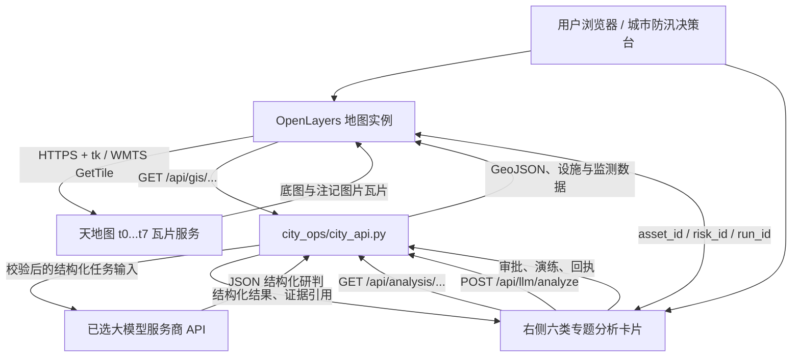
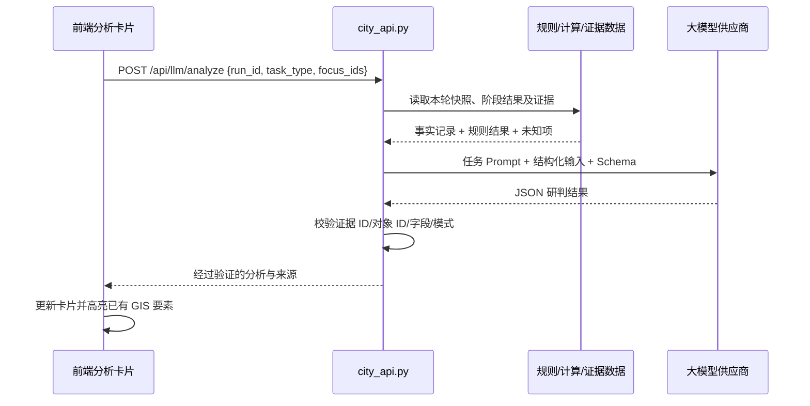

# 天地图 + OpenLayers：城市防汛 GIS 接入与大模型研判联动实施指南

> 文档版本：v1.0  
> 编写日期：2026-10-10  
> 适用工程：`city_ops/dashboard/index.html`、`city_ops/city_api.py`  
> 文档用途：用于将现有城市防汛演示沙盘升级为基于天地图的真实城市地理底图，并保留六阶段分析、智能研判与人工方案闭环。可直接交给 Codex/前后端工程人员实施。

---

## 0. 建设目标、已有条件与不可混淆的边界

### 0.1 当前工程事实

依据《城市防汛前端设计说明》（2026-10-10）：

- 当前页面：`city_ops/dashboard/index.html`，由 `city_ops/city_api.py` 直接返回；原开发地址为 `http://127.0.0.1:8090/`。
- 左侧使用固定坐标的 `640×640` SVG 示意沙盘，无真实经纬度、无平移缩放能力。
- 现有对象：`U01` 下穿通道、`P01` 泵站、`L12` 上游管段、`team-01` 巡检队、`mobile-pump-01` 移动泵；现有坐标只是 SVG 像素坐标，**不是地理经纬度**。
- 后台有六阶段：`sensing`、`compute`、`disposition`、`intent`、`risk_id`、`risk_response`。
- 已有分析轮次查询、刷新、方案审批、演练派发、回执接口；既有示例 `0.18 m` 水深为**合成快照**，不是厦门实测值。
- 用户已申请天地图 API Key，计划使用“方案 A：天地图 + OpenLayers”。

### 0.2 本次开发交付目标

1. 真实地图：左栏展示厦门市选定片区的**真实天地图底图**，支持平移、缩放、地理定位、底图切换。
2. 地图图层：加载本地/后端 GeoJSON，绘制监测点、设施、排水网络、风险警示线；所有风险与设施几何均有数据来源。
3. 交互联动：右侧卡片选择对象时，地图自动定位/高亮；点击地图对象时，右侧切换对应分析卡片。
4. 多源研判：保留后台六阶段数据处理；将模型输出设计为“证据可追溯的结构化研判”，不让 LLM 编造地理坐标和水位。
5. 原流程兼容：继续支持“再分析一轮→阅读历史轮次→选择方案→人工审批→登记演练→填写回执”。
6. 数据可信：区分真实底图、合成观测、历史回放、模型预测；资料不充分时显示“待核验/无数据”，**不绘制假的真实洪涝范围**。

### 0.3 关键结论

> **天地图 = 地图瓦片/地名/影像等服务供应方。**  
> **OpenLayers = 运行在浏览器的开源 GIS 引擎，负责渲染、缩放、图层、事件、动画。**  
> **`city_api.py` = 业务服务器，负责设施、监测、风险 GeoJSON、分析结果和方案接口。**  
> **LLM API = 智能研判服务，不负责获取底图、也不负责凭空生成洪涝几何。**

天地图的 `vec_w` 名称虽叫“矢量底图”，通过该 WMTS 接口返回的通常是**渲染后的瓦片图像**，并不能直接得到“可点击的一条道路的 GeoJSON”。要点击风险道路、泵站、管网并获得业务详情，需由自身后端提供带标识的业务几何要素。

---

## 1. 总体技术架构与服务请求过程



### 1.1 谁与谁交互

| 发起方 | 目标 | 请求/数据 | 目的 |
|---|---|---|---|
| 浏览器中的 OpenLayers | 天地图 | WMTS `GetTile` URL + `tk` | 真实底图图片与地名注记 |
| 浏览器中的 OpenLayers | 业务后端 | `/api/gis/assets` 等 | 设施点、警示线、积水区域等 GeoJSON |
| 右侧卡片 | 业务后端 | `/api/analysis/{run_id}` | 读取原六阶段结果 |
| 右侧卡片 | 业务后端 | `/api/llm/analyze` | 触发或读取模型研判 |
| 业务后端 | 大模型供应商 | 内部模型请求 | 综合事实、证据和约束生成分析 |
| 右侧方案区 | 业务后端 | `/api/plans/approve` 等 | 保留人工审批与操作回执 |

**天地图 Key 与大模型 API Key 必须分别管理。** 天地图 Web Key 可能会随瓦片请求暴露在浏览器网络面板，大模型私密 Key 应只存在服务端。

---

## 2. 天地图接入：服务形式、URL 和认证

### 2.1 推荐使用 WMTS 墨卡托地图

在 OpenLayers 默认 EPSG:3857 视图下，优先使用天地图 `_w` 图层：

| 底图类型 | 服务标识 | 适用情况 |
|---|---|---|
| 线划/矢量风格底图 | `vec_w` | 默认城市 GIS 底图，适合叠加业务点线 |
| 矢量注记 | `cva_w` | 中文道路/地名，随矢量底图显示 |
| 影像底图 | `img_w` | 查看实际地表形态，适合现场空间背景 |
| 影像注记 | `cia_w` | 在影像上显示中文地名 |

常用 WMTS URL 模板（**不要把真实 Key 提交到公开代码仓库**）：

```text
https://t0.tianditu.gov.cn/vec_w/wmts?
SERVICE=WMTS&REQUEST=GetTile&VERSION=1.0.0&
LAYER=vec&STYLE=default&TILEMATRIXSET=w&FORMAT=tiles&
TILEMATRIX={z}&TILEROW={y}&TILECOL={x}&tk=YOUR_TDT_KEY
```

`vec` 换成 `cva/img/cia`，URL 路径分别换成 `cva_w/img_w/cia_w` 即可。

### 2.2 参数说明

| 参数 | 含义 | 谁来设置 |
|---|---|---|
| `SERVICE=WMTS` | 指定 WMTS 服务 | 固定配置 |
| `REQUEST=GetTile` | 请求单个地图瓦片 | 固定配置 |
| `VERSION=1.0.0` | 协议版本 | 固定配置 |
| `LAYER=vec` | 底图层名称 | 前端底图选择控制 |
| `TILEMATRIXSET=w` | 墨卡托瓦片矩阵集 | 与 `_w` 底图配套 |
| `TILEMATRIX={z}` | 缩放层级 | OpenLayers 自动计算 |
| `TILEROW={y}` | 瓦片行号 | OpenLayers 自动计算 |
| `TILECOL={x}` | 瓦片列号 | OpenLayers 自动计算 |
| `tk=...` | 天地图开发者 Key | 用网站适用的 Key 配置 |

OpenLayers 的 `ol.source.XYZ` 可以直接使用与 XYZ 顺序兼容的天地图 `_w` GetTile URL，**不需要为最小实现手动处理行列号**。若未来需要把瓦片画入可导出的 Canvas，再视天地图是否提供允许跨域访问的响应头配置 `crossOrigin`；普通瓦片展示通常不必主动设置。如后期改用 `_c` 经纬度投影，应重新配置对应投影及 tile grid，不能仅替换 URL 后缀。

### 2.3 先验证 Key：不用编写应用也能检测

把 `YOUR_TDT_KEY` 替换成自己的 Key，在浏览器中打开下列**单瓦片请求**；示例 `z=10, x=847, y=440` 为厦门附近的一张瓦片，不用于标记真实设施：

```text
https://t0.tianditu.gov.cn/vec_w/wmts?SERVICE=WMTS&REQUEST=GetTile&VERSION=1.0.0&LAYER=vec&STYLE=default&TILEMATRIXSET=w&FORMAT=tiles&TILEMATRIX=10&TILEROW=440&TILECOL=847&tk=YOUR_TDT_KEY
```

预期：浏览器返回一张地图图片，而不是权限错误、XML 异常页面或空白。若失败，依次检查 Key 是否激活、申请应用类型、允许来源域名/服务配额、网络 HTTPS、接口路径与参数。**不要为了绕过 Key 授权限制而擅自使用后端代理**。

也可以用命令行检查 HTTP 状态码及 MIME 类型：

```bash
curl -L -I 'https://t0.tianditu.gov.cn/vec_w/wmts?SERVICE=WMTS&REQUEST=GetTile&VERSION=1.0.0&LAYER=vec&STYLE=default&TILEMATRIXSET=w&FORMAT=tiles&TILEMATRIX=10&TILEROW=440&TILECOL=847&tk=YOUR_TDT_KEY'
```

`HEAD` 方法可能因供应商服务策略而不被支持；若不能确认，使用浏览器实际 GET 请求及开发者工具的 Network 面板检查更可靠。

**供应商交互要点：**你平时并不需要手动逐次调用地图 API。OpenLayers 初始化后将按视角自动调用 WMTS；只有配额、申请权限、域名白名单、商用条款、瓦片缓存策略等问题，需要在天地图开发者后台/供应商服务规则中核实。

---

## 3. 第一个可运行交付：`map-test.html`

### 3.1 目标

独立于现有业务系统，先确认可以在浏览器中：

- 展示厦门附近的真实城市底图；
- 平移/缩放；
- 切换矢量与影像底图；
- 在页面展示加载报错，而不是“空白一片却不知道原因”。

### 3.2 最小 HTML 示例

建议开发阶段直接保存为 `city_ops/dashboard/map-test.html`，通过 HTTP 静态服务访问；也可暂时另存到其他静态目录。该示例使用 OpenLayers 官方发布的完整浏览器构建版，**适用于接入验证，不是正式生产打包建议**。

```html
<!DOCTYPE html>
<html lang="zh-CN">
<head>
  <meta charset="UTF-8" />
  <meta name="viewport" content="width=device-width, initial-scale=1" />
  <title>天地图 + OpenLayers 验证</title>
  <link rel="stylesheet" href="https://cdn.jsdelivr.net/npm/ol@10.11.0/ol.css" />
  <script src="https://cdn.jsdelivr.net/npm/ol@10.11.0/dist/ol.js"></script>
  <style>
    html, body { margin: 0; width: 100%; height: 100%; }
    body { font-family: "Microsoft YaHei UI", sans-serif; background: #09130f; }
    #city-map { position: absolute; inset: 0; }
    .toolbar {
      position: absolute; z-index: 10; top: 18px; left: 56px;
      display: flex; align-items: center; gap: 8px;
      padding: 9px 12px; color: #e5f5eb;
      background: rgba(12, 27, 23, .92); border-radius: 12px;
    }
    .toolbar button { padding: 7px 10px; cursor: pointer; }
    #status { font-size: 12px; color: #c4ded1; }
  </style>
</head>
<body>
  <div id="city-map"></div>
  <div class="toolbar">
    <button id="vector">矢量底图</button>
    <button id="image">卫星影像</button>
    <span id="status">初始化中</span>
  </div>
  <script>
    // 仅使用适合浏览器的天地图 Web Key；不要写入大模型密钥。
    const TDT_KEY = "YOUR_TDT_KEY";
    const statusEl = document.getElementById("status");

    if (!window.ol) {
      statusEl.textContent = "OpenLayers 加载失败，请检查 CDN 网络";
      throw new Error("OpenLayers library not loaded");
    }
    if (TDT_KEY === "YOUR_TDT_KEY") {
      statusEl.textContent = "请先填写天地图 Key";
    }

    function createLayer(name, visible) {
      const url =
        `https://t0.tianditu.gov.cn/${name}_w/wmts` +
        `?SERVICE=WMTS&REQUEST=GetTile&VERSION=1.0.0` +
        `&LAYER=${name}&STYLE=default&TILEMATRIXSET=w` +
        `&FORMAT=tiles&TILEMATRIX={z}&TILEROW={y}&TILECOL={x}` +
        `&tk=${encodeURIComponent(TDT_KEY)}`;
      const source = new ol.source.XYZ({
        url,
        attributions: "© 天地图"
      });
      source.on("tileloaderror", () => {
        statusEl.textContent = "瓦片加载失败：检查 Key、授权和网络";
      });
      return new ol.layer.Tile({ source, visible });
    }

    const vec = createLayer("vec", true);
    const cva = createLayer("cva", true);
    const img = createLayer("img", false);
    const cia = createLayer("cia", false);

    const map = new ol.Map({
      target: "city-map",
      layers: [vec, img, cva, cia],
      view: new ol.View({
        center: ol.proj.fromLonLat([118.0894, 24.4798]),
        zoom: 13,
        minZoom: 4,
        maxZoom: 18
      })
    });

    function switchBase(type) {
      const satellite = type === "image";
      vec.setVisible(!satellite);
      cva.setVisible(!satellite);
      img.setVisible(satellite);
      cia.setVisible(satellite);
      statusEl.textContent = satellite ? "卫星影像模式" : "矢量底图模式";
    }
    document.getElementById("vector").onclick = () => switchBase("vector");
    document.getElementById("image").onclick = () => switchBase("image");
    switchBase("vector");

    window.map = map;  // 仅调试用途
  </script>
</body>
</html>
```

> 这里用的 `[118.0894, 24.4798]` 仅作为**厦门地图初始视角**。它不是 U01、P01 或其他真实设施坐标。

### 3.3 如何启动测试服务

若已有 Python 环境，可在项目根目录启动一个临时静态服务：

```bash
python -m http.server 8091 --directory city_ops/dashboard
```

浏览器访问：`http://127.0.0.1:8091/map-test.html`。

> 注意：原 `city_api.py` 可能仅返回根页面并不托管任意 HTML 文件，因此不应假定现有的 `http://127.0.0.1:8090/map-test.html` 一定有效。测试阶段可使用上面的独立静态服务。正式集成后继续由原 `city_api.py` 返回主页面。

### 3.4 首次验证清单

- [ ] OpenLayers JS/CSS 网络请求成功。
- [ ] 天地图 `vec_w` / `cva_w` 返回地图瓦片。
- [ ] 地图自动定位厦门市区，拖拽、缩放正常。
- [ ] 切换“卫星影像”后加载 `img_w` / `cia_w`。
- [ ] 左下角或地图 Attribution 显示来源信息，不擅自移除地图版权/审图标识。
- [ ] 瓦片请求失败时页面有可定位的错误信息。

---

## 4. 第二步：把 OpenLayers 嵌入现有 `index.html`

### 4.1 替换原则

只替换**左栏 SVG 地图的绘制层**，不要删除右栏轮次、阶段详情或审批表单。

原来：

```text
#map-frame
  SVG 640×640 示意街区
  SVG 水力连线
  SVG 积水椭圆
  SVG 设施点
```

改为：

```text
#map-frame
  #city-map（OpenLayers 挂载容器）
  .map-toolbar（图层开关、定位、模式）
  .map-legend（真实/演示/待核验说明）
  .map-overlay-status（瓦片加载与数据状态）
```

CSS 核心约束：地图父容器必须有真实宽高，不能只给 `height: 100%` 而父元素高度为 `auto`；不改变主页面既有暗绿配色与左图右过程的结构。

```css
.map-frame { position: relative; min-height: 460px; overflow: hidden; }
#city-map { position: absolute; inset: 0; }
.map-toolbar { position: absolute; top: 12px; right: 12px; z-index: 20; }
.map-legend { position: absolute; bottom: 12px; left: 12px; z-index: 20; }
```

### 4.2 推荐代码组织（渐进式迁移）

第一版可以继续单文件 HTML；功能稳定后建议拆分：

```text
city_ops/
├── city_api.py                  # 现有业务接口，保持兼容
├── dashboard/
│   ├── index.html               # 现有决策台入口
│   ├── map-test.html            # 独立接入验证，可在正式版移除
│   ├── js/
│   │   ├── gis-map.js           # OpenLayers 创建与底图切换
│   │   ├── gis-layers.js        # GeoJSON 数据图层、地图交互
│   │   ├── analysis-panel.js    # 右侧卡片及分析轮次联动
│   │   └── api-client.js        # fetch、响应校验、错误处理
│   └── css/
│       └── gis.css              # 地图容器、浮层、图例
├── gis/
│   ├── schemas.py               # GeoJSON/字段校验（建议）
│   ├── gis_routes.py            # GIS API（建议）
│   └── fixture_data.py          # 演示图层（建议）
└── analysis/
    └── llm_service.py           # 大模型任务路由（建议）
```

如果拆成静态文件，必须同时修改 `city_api.py` 以提供静态资源路由或部署独立静态服务器；不能只拆文件，不提供访问路径。

---

## 5. 第三步：GIS 数据结构、图层与地图交互

### 5.1 图层设计

| 图层 | 数据来源 | 几何类型 | 显示方式 | 交互方式 |
|---|---|---|---|---|
| 真实底图 | 天地图 `vec_w/img_w` | WMTS 图片瓦片 | 常驻 | 平移、缩放、切换 |
| 地名注记 | 天地图 `cva_w/cia_w` | WMTS 图片瓦片 | 常驻 | 不当成业务对象 |
| 设施 | 自有台账 `assets` | GeoJSON Point | 图标、名称、运行状态 | 点击查看详情 |
| 管网/水力连接 | 自有拓扑 `hydraulic_links` | GeoJSON LineString | 青绿线/箭头 | 点击看上下游证据 |
| 监测 | 自有观测记录 | GeoJSON Point + 序列数据 | 水深、趋势、异常 | 点击看曲线和来源 |
| 风险警示线 | 规则/GIS/有效模型结果 | GeoJSON LineString | 虚线、颜色、受控动画 | 点击展开风险卡片 |
| 淹没边界 | 经过验证的空间结果 | GeoJSON Polygon/MultiPolygon | 半透明填充 | 时间轴切换、结果溯源 |
| 应急资源 | 自有资源台账 | GeoJSON Point | 队伍/移动泵符号 | 关联应对方案 |

**禁止**把单个水深观测值自动扩展为未知城市面积的二维淹没边界。没有模型或地理证据时不返回淹没几何。

### 5.2 GIS 后端接口清单（新增建议）

| HTTP | 路径 | 响应 | 备注 |
|---|---|---|---|
| `GET` | `/api/gis/config?site_id=demo-district` | 初始地图范围、投影、可用图层 | 不返回任何高权限密钥 |
| `GET` | `/api/gis/assets?site_id=demo-district` | `FeatureCollection` | 只有有效地理位置的设施才绘制 |
| `GET` | `/api/gis/observations?run_id=...` | 带地理引用的观测点 | 不含空间坐标的观测只显示在卡片中 |
| `GET` | `/api/gis/hydraulic-links?run_id=...` | `FeatureCollection` | 已知空间管网或水力关联 |
| `GET` | `/api/gis/risk-lines?run_id=...` | `FeatureCollection` | 合成场景须明确 `synthetic_replay` |
| `GET` | `/api/gis/flood-extent?run_id=...&time=...` | `FeatureCollection` 或空集合 | 没有有效边界时返回空，不臆造 |
| `GET` | `/api/gis/resource-points?run_id=...` | `FeatureCollection` | 队伍与设备位置及有效时间 |

上表是**规划新增的接口**，并非现有 `city_api.py` 已经实现。

### 5.3 GeoJSON 示例：演示警示线

下例仅用于测试前后端绘图，给定坐标是**虚构的演示几何，不代表真实风险道路**：

```json
{
  "type": "FeatureCollection",
  "features": [
    {
      "type": "Feature",
      "id": "risk-demo-001",
      "properties": {
        "risk_id": "risk-demo-001",
        "title": "演示警示线",
        "asset_id": null,
        "run_id": "demo-run-001",
        "data_mode": "synthetic_replay",
        "risk_status": "scenario_only",
        "source": "manual_demo_geometry",
        "risk_level": null,
        "official_warning": false
      },
      "geometry": {
        "type": "LineString",
        "coordinates": [
          [118.085, 24.480],
          [118.087, 24.481],
          [118.090, 24.482]
        ]
      }
    }
  ]
}
```

**坐标约定：** 所有业务 GeoJSON 默认 `EPSG:4326`，顺序为 `[longitude, latitude]`（先经度、后纬度）；加载时由 OpenLayers 投影转换到地图的 `EPSG:3857`。

真实设备台账只有内部设施号但没有真实经纬度时，应返回空图层并在右侧显示“缺少定位信息”，不能把原 SVG 像素位置直接当经纬度。

### 5.4 将风险线加入 OpenLayers

下列代码依赖第 3 节已创建的 `map` 和 `ol`，用在 `index.html` 的地图初始化之后，或移入 GIS 图层模块：

```javascript
const riskSource = new ol.source.Vector();
const riskStyle = new ol.style.Style({
  stroke: new ol.style.Stroke({
    color: "#ff9957",
    width: 5,
    lineDash: [12, 8]
  })
});
const riskLayer = new ol.layer.Vector({
  source: riskSource,
  style: riskStyle,
  zIndex: 20
});
map.addLayer(riskLayer);

async function loadRiskLines(runId) {
  const url = `/api/gis/risk-lines?run_id=${encodeURIComponent(runId)}`;
  const response = await fetch(url);
  if (!response.ok) throw new Error(`风险图层 HTTP ${response.status}`);
  const data = await response.json();
  if (data.type !== "FeatureCollection") {
    throw new Error("风险图层不是有效 GeoJSON FeatureCollection");
  }
  const features = new ol.format.GeoJSON().readFeatures(data, {
    dataProjection: "EPSG:4326",
    featureProjection: "EPSG:3857"
  });
  riskSource.clear();
  riskSource.addFeatures(features);
}

map.on("singleclick", (event) => {
  const feature = map.forEachFeatureAtPixel(event.pixel, (f, layer) => {
    return layer === riskLayer ? f : null;
  });
  if (!feature) return;
  const riskId = feature.get("risk_id");
  // 用实际右栏状态管理函数替换以下占位调用：
  openRiskAnalysisTab(riskId);
});
```

`openRiskAnalysisTab` 是当前工程需要新建/对接的业务函数，不是 OpenLayers 提供的全局函数。必须实现“选择风险卡片 → 按 ID 加载详情/切换 Tab”的行为，不能只在控制台打印信息。

### 5.5 右侧选择设施，左侧自动定位

```javascript
function focusFeature(feature) {
  if (!feature || !feature.getGeometry()) return;
  map.getView().fit(feature.getGeometry().getExtent(), {
    padding: [100, 100, 100, 100],
    maxZoom: 16,
    duration: 450
  });
  // 可在独立高亮图层复制当前要素并应用高亮样式
}
```

强制使用 `asset_id`、`risk_id`、`run_id` 连接地图、卡片、证据与轮次。不要使用“第几个圆点”或 UI 文字名称进行关联，因为图层顺序和显示名称可能变化。

### 5.6 三类动画的实现方式

| 可视化动画 | 技术实现 | 需要的数据 | 不允许的误导 |
|---|---|---|---|
| 风险警示线闪动 | Vector + Stroke 虚线偏移/样式周期更新 | 已存在的风险 LineString | 不能把演示线称为官方警报 |
| 排水方向流光 | 管网 LineString + 箭头/粒子动画 | 真实网络方向或明示仿真网络 | 动画速度不代表真实流量 |
| 积水区域时序演化 | 时间轴切换 Polygon/GeoJSON 或栅格图层 | 各时刻有效的空间结果 | 不能由单点水深推导未知面积 |

建议优先完成**静态真实地理几何 + 可点选**，再增加动画。动画必须提供关闭选项，避免影响性能、可读性和用户无障碍体验。

### 5.7 数据与图层状态设计

每个地图要素建议带：

```text
feature_id          唯一编号
run_id              分析轮次
site_id             片区编号
data_mode           realtime / historical_replay / synthetic_replay / model_prediction
source_id           来源设备/台账/模型编号
observed_at         观测时间（如有）
computed_at         计算时间（如有）
geometry_source     真实台账/人工绘制/模型输出
validation_status   verified / pending / invalid
```

地图上至少设置“底图来源”“当前数据模式”“最新观测时间”“风险图层更新状态”四类状态信息。

---

## 6. 第四步：右侧六阶段与六个研判 Tab 如何联动

保留当前六阶段业务数据结构，不直接改名破坏接口；从**用户阅读维度**增加右侧 Tab：

| 前端 Tab | 主要读取阶段 | 地图联动 | LLM 任务 |
|---|---|---|---|
| 综合态势 | 六阶段摘要 + 当前快照 | 高亮当前重点对象 | `situation_summary` |
| 水情分析 | `sensing` + `compute` | 积水点、潮位/雨量点、泵站 | `hydrology_explanation` |
| 成因研判 | `disposition` + `intent` | 上下游设施、候选成因证据 | `cause_analysis` |
| 风险评估 | `risk_id` | 风险对象与已有风险几何 | `risk_explanation` |
| 应对方案 | `risk_response` + `plans` | 方案相关资源/设施 | `plan_comparison` |
| 分析依据 | 全部阶段证据与校验信息 | 点击证据聚焦对象 | `evidence_summary` |

**双向交互规范：**

1. 点击右栏某个 Tab：加载或复用当前轮次分析；切换地图图层可见性与高亮对象。
2. 点击地图上的 `asset_id` / `risk_id`：前端确定匹配的右栏卡片，展示该对象相关证据。
3. 轮次切换：右侧数据与所有自有 GIS 图层一起更新；地图底图不需要重新实例化。
4. 分析正在执行时：显示任务状态，禁止把旧轮次结果误当成新轮次。
5. 人工审批与演练派发仍保留在应对方案页；地图点击本身不触发真实操作。

---

## 7. 第五步：大模型 API 与 GIS 的交互边界

### 7.1 模型不直接访问天地图瓦片

地图底图属于视觉地理背景，现阶段**不需要向 LLM 发送每一张地图瓦片图片**。LLM 需要的是经过业务后端整理的结构化事实：对象、时间、监测趋势、异常设施、水力拓扑、证据编号和待核验问题。



### 7.2 前端 → 后端：统一研判请求（建议新增）

```http
POST /api/llm/analyze
Content-Type: application/json
```

```json
{
  "site_id": "demo-district",
  "run_id": "demo-run-001",
  "task_type": "cause_analysis",
  "focus_ids": ["P01", "L12", "U01"],
  "regenerate": false
}
```

字段解释：

- `run_id`：锁定使用哪一轮分析，不允许从最新数据中混入另一轮的事实。
- `task_type`：决定任务专用 Prompt 和输出 Schema。
- `focus_ids`：仅指定用户关注的有效对象 ID，**不接收模型自造坐标**。
- `regenerate`：控制是否重新请求大模型；默认建议使用缓存。

### 7.3 后端 → 大模型：结构化任务上下文

下面是**业务任务示例**，数值仍对应原合成数据的演示情境：

```json
{
  "task_type": "cause_analysis",
  "run_id": "demo-run-001",
  "data_mode": "synthetic_replay",
  "facts": [
    {
      "evidence_id": "E01",
      "asset_id": "U01",
      "type": "observed_depth",
      "value": 0.18,
      "unit": "m"
    },
    {
      "evidence_id": "E02",
      "asset_id": "P01",
      "type": "pump_fault_flag",
      "value": true
    }
  ],
  "hydraulic_links": [["L12", "U01"], ["U01", "P01"]],
  "unknowns": ["pipe_blockage_status", "rainfall_observations"],
  "instruction": "区分事实和假设；引用证据ID；不得虚构堵塞事实、官方预警等级、坐标或淹没范围。"
}
```

### 7.4 模型结构化输出范式

```json
{
  "task_type": "cause_analysis",
  "summary": "监测到泵站异常标志，可能影响相关排水过程；管段堵塞仍待核验。",
  "hypotheses": [
    {
      "hypothesis_id": "H01",
      "statement": "泵站异常可能降低排水效率",
      "status": "supported_as_hypothesis",
      "supporting_evidence_ids": ["E02"],
      "counter_evidence_ids": [],
      "limitations": ["缺少故障持续时间及泵站实际排水流量记录"]
    }
  ],
  "unknowns": ["pipe_blockage_status", "rainfall_observations"],
  "verification_actions": ["核实 P01 当前运行状态", "检查 L12 是否存在堵塞"],
  "official_warning": false
}
```

此 JSON 只是任务返回格式示例，不代表大模型已经执行或结果经过专家验证。

### 7.5 服务端必须执行的校验

- **Schema 校验**：`task_type`、数组、ID、字段类型及枚举必须符合约束。
- **证据校验**：所有 `supporting_evidence_ids` 必须存在于当前轮次可访问的证据集合中。
- **对象校验**：设施或风险 ID 必须在当前片区的资产/风险目录中；不允许插入未知资产。
- **空间校验**：风险 geometry 由 GIS 服务提供；LLM 自行输出的坐标/Polygon 不直接上图。
- **分级校验**：缺少官方或项目明确配置的阈值时，风险等级为 `pending_verification`，不可自造“红色预警”。
- **权限校验**：模型生成的文字不得跳过原有 `approve/dispatch/receipt` 人工闭环。
- **缓存与版本**：缓存键至少包含 `run_id + task_type + focus_ids + prompt_version + model_version`；保存推理时间与使用的证据版本。

### 7.6 六类任务建议输出字段

| 任务 | 主要输出字段 |
|---|---|
| `situation_summary` | `summary`, `key_changes`, `focus_asset_ids`, `unknowns` |
| `hydrology_explanation` | `observed_trends`, `possible_factors`, `limitations`, `evidence_ids` |
| `cause_analysis` | `hypotheses`, `supporting_evidence_ids`, `counter_evidence_ids`, `verification_actions` |
| `risk_explanation` | `risk_objects`, `risk_types`, `trigger_evidence_ids`, `unknowns` |
| `plan_comparison` | `candidate_ids`, `resource_requirements`, `preconditions`, `tradeoffs` |
| `evidence_summary` | `evidence_items`, `quality_flags`, `missing_data`, `model_metadata` |

### 7.7 与前端地图联动的返回格式（建议）

后端在通过 LLM 校验后，可额外生成只含已知对象的 `map_focus`：

```json
{
  "run_id": "demo-run-001",
  "task_type": "cause_analysis",
  "analysis_status": "completed",
  "data_mode": "synthetic_replay",
  "result": {
    "summary": "示例：需要优先核验泵站故障记录与上游管段状态。"
  },
  "map_focus": {
    "asset_ids": ["P01", "L12"],
    "risk_ids": []
  },
  "validation": {
    "status": "checked",
    "unresolved_items": 2
  }
}
```

前端只根据 `asset_ids` / `risk_ids` 与地图上**已经存在且可定位的 GeoJSON 要素**匹配、定位、高亮；找不到坐标时在卡片中提示“该设施暂无地理定位数据”。

---

## 8. 旧接口兼容与分析轮次状态管理

以下为现有接口，应继续保留：

```text
GET  /api/analysis/runs?site_id=demo-district
GET  /api/analysis/latest?site_id=demo-district
GET  /api/analysis/{run_id}
POST /api/analysis/refresh
POST /api/plans/approve
POST /api/plans/dispatch
POST /api/tasks/receipt
```

数据状态建议集中管理：

```javascript
const state = {
  siteId: "demo-district",
  runId: null,
  activeTab: "situation",
  activeStage: "sensing",
  selectedAssetId: null,
  selectedRiskId: null,
  mapLayersLoadedForRunId: null,
  analysisByTask: {},
  dataMode: "synthetic_replay"
};
```

实现时必须保证：

1. 地图实例仅创建一次；**不要每次切换 Tab 或轮次都重新创建 OpenLayers Map**。地图父容器从隐藏切为可见或尺寸变化时调用 `map.updateSize()`。
2. `run_id` 变化时刷新 GIS 数据源和右侧卡片数据；对旧请求设置取消或响应轮次校验，防止乱序覆盖。
3. 当新风险接口不可用时，底图和旧分析流程仍能正常工作；图层展示为“暂不可用”而非假数据。
4. 原始审批、演练和回执状态按照 API 真值更新，不能仅靠按钮反馈文案猜测已完成。
5. 当前 demo 分析每次刷新不一定改变水深；不要通过随机改变地图画面伪造“新的实时数据”。

---

## 9. 数据真实性、安全与上线约束

### 9.1 四种运行模式

| `data_mode` | 来源 | 界面要求 |
|---|---|---|
| `realtime` | 实际监测接入 | 显示设备、观测时间、数据时延 |
| `historical_replay` | 已有历史记录 | 显示事件日期与原始数据编号 |
| `synthetic_replay` | 合成样例/人工演练 | 明确显示“合成回放/演示数据” |
| `model_prediction` | 经过验证的计算预测 | 显示预测起报时间、时效、模型版本 |

**天地图真实底图**只代表地理底图来自真实地图服务，并不代表叠加的积水、风险或设施状态自动变成真实。

### 9.2 Key 与配额安全

- 天地图浏览器 Key 应按服务商可用的域名/应用约束管理，避免外泄与滥用；浏览器请求 URL 中暴露 Key 属于 Web 图服务的常见使用方式，但不能等同于服务器端秘密。
- LLM 私钥仅保存在后端环境变量/密钥管理服务，不得写入 HTML/前端 bundle 或浏览器响应。
- 配置地图服务请求监测、错误率、配额告警；遵守天地图来源署名及服务许可。
- 不应未经许可通过代理、批量爬取、离线存储瓦片绕过授权或调用限制。
- 正式公开地图或向第三方交付前，还应核实适用地图使用、审图与数据安全要求。

### 9.3 坐标与投影注意事项

- 前端 OpenLayers 视图：`EPSG:3857`；GIS 数据 API：统一 `EPSG:4326` GeoJSON，经纬度顺序 `[lon, lat]`。
- 从 `EPSG:4326` 转换到 `EPSG:3857` 可使用 `ol.proj.fromLonLat` 或 `GeoJSON.readFeatures` 的 `featureProjection`。
- 项目如引入第三方 GCJ-02/BD-09 坐标，必须核实数据来源和转换关系；不要直接当 `EPSG:4326` 叠加，防止位置偏移。
- 原 SVG `U01=(330,390)`、`P01=(500,330)` 等像素坐标**不能通过任意比例换算直接成为真实经纬度**。

---

## 10. 实施优先级、任务分解和验收标准

### P0：真实 GIS 底图与最小联动

**任务：**

- [ ] 验证 Key 及 `vec_w/cva_w/img_w/cia_w` 瓦片请求。
- [ ] 独立完成 `map-test.html`，显示厦门城区并能切换底图。
- [ ] 将 OpenLayers 装入现有 `index.html` 左栏，移除固定 SVG 图作为唯一主图。
- [ ] 保留原有六阶段轮次与审批、演练、回执功能。
- [ ] 实现 `/api/gis/assets` 与 `/api/gis/risk-lines` 基本 GeoJSON 接口；缺真实坐标时返回空集合并显示提示。
- [ ] 实现右卡片→地图、地图→右卡片双向联动；默认不自动生成风险几何。

**验收：**地图真实、缩放拖动正常、底图切换正常、业务对象不会错误定位、右侧原流程未回归。

### P1：多维专题研判、动态风险线与证据链

**任务：**

- [ ] 完成右侧六类专题 Tab；六阶段仍作为内部分析流程。
- [ ] 接入 `/api/llm/analyze`，实现任务路由、Schema、证据 ID 校验及结果缓存。
- [ ] 增加已有 GeoJSON 风险警示线动画与图层图例。
- [ ] 实现历史水情曲线与时序回放；预测与观测分开标识。
- [ ] 在右侧展示“证据来源/待核验问题/模型状态”；增设 LLM 异常降级。

**验收：**模型断连也可查看事实数据；输入输出可追溯；风险动画不会伪造实时数值和官方预警。

### P2：真实监测、多情景与空间影响分析

**任务：**

- [ ] 对接有权限的监测与资产台账，建立设备坐标、时间和数据质量机制。
- [ ] 引入经过验证的二维淹没/积水空间结果及时间轴。
- [ ] 实现 A/B 方案对比，展示资源前置条件和地图影响对象。
- [ ] 形成事件—快照—轮次—处置—回执—复盘链路。
- [ ] 根据授权和合规要求完成部署审查、日志审计和性能测试。

**验收：**所有地图几何有来源且可追溯；能解释每个方案使用了哪些事实、规则与模型输出。

### 10.1 必须覆盖的异常测试

| 情况 | 应有表现 |
|---|---|
| 天地图 Key 错误或超额 | 地图明确报错，不影响右侧已有分析 |
| OpenLayers CDN 失败 | 页面提示前端依赖加载失败，不无限等待 |
| 天地图图层无响应 | 地图显示加载失败状态；保留自己的业务数据入口 |
| 某资产无真实经纬度 | 不在真实地图上强行画点；卡片提示缺少定位 |
| GeoJSON 无效 | 层级校验失败，显示异常；不影响其他图层 |
| GIS API 返回 404/500 | 该图层进入错误状态，不能临时画假风险线 |
| 切换轮次很快 | 不允许旧轮次请求覆盖当前风险图层 |
| 大模型返回未知证据 ID | 后端阻断或标记为无效输出 |
| 大模型返回未知设施坐标 | 不渲染；仅显示已有并验证的空间对象 |
| 无风险分级阈值 | 显示“待核验”，不得自动变为官方红色预警 |
| 审批前尝试派发 | 与现有服务一致，服务器拒绝并在 UI 告知原因 |
| 合成数据模式 | 全程保留“演示/合成”标识 |

---

## 11. 可直接交给 Codex 的开发指令

> 请在现有 `city_ops` 工程上完成“天地图 + OpenLayers”地图替换和前后端集成，遵循如下要求：
>
> 1. 先阅读 `city_ops/dashboard/index.html`、`city_ops/city_api.py`、相关数据结构与现有接口测试，再开发；不得臆测接口已实现。
> 2. 使用 OpenLayers 作为浏览器地图渲染器，调用用户已申请的天地图 Web Key，通过 `_w` 系列 WMTS 底图（`vec/cva/img/cia`）显示厦门城市地图。
> 3. 首先提供独立地图验证页，验证 Key、地图缩放、底图切换与加载失败提示；之后替换主页面左栏 SVG。地图样式与原暗绿大屏风格兼容。
> 4. 自有 GIS 数据从后端 GeoJSON 接口加载；实现设施、监测、管网、风险线等图层开关和地图—右侧卡片双向联动。
> 5. 禁止把既有 `640×640` SVG 坐标伪装成真实地理经纬度；缺坐标不绘制。测试风险线可使用显式标注“演示”的 GeoJSON，必须与真实风险显示隔离。
> 6. 保留原有六阶段 `sensing/compute/disposition/intent/risk_id/risk_response` 和分析轮次、审批、派发、回执接口及其行为。
> 7. 右侧增加六类专题 Tab；经 `city_api.py` 的 `/api/llm/analyze` 统一调用模型，使用后端证据数据、任务模板、结构化输出与证据校验。大模型 API Key 不可出现在浏览器中。
> 8. 大模型不得自行生成“有依据的真实风险范围”、官方警报或未知资产位置；地图几何仅由可靠 GIS 数据/显式演示数据生成。
> 9. 增加加载/错误/无数据/合成模式状态，执行相应回归测试。
> 10. 按 P0→P1→P2 分阶段提交，逐项说明变更文件、运行命令、接口契约、测试结果和暂未具备的数据能力。第一阶段不要求虚构完整实时城市业务数据。

---

## 12. 官方资料与进一步阅读

1. **OpenLayers 官方文档及最新获取方式**：<https://openlayers.org/download/>
2. **OpenLayers 官方 WMTS 示例**：<https://openlayers.org/en/latest/examples/wmts.html>
3. **OpenLayers 官方矢量图层示例**：<https://openlayers.org/en/latest/examples/vector-layer.html>
4. **OpenLayers 官方 API 文档**：<https://openlayers.org/en/latest/apidoc/>
5. **天地图开放平台及服务说明**：<https://lbs.tianditu.gov.cn/>
6. **天地图地图服务接口参考**：<https://lbs.tianditu.gov.cn/server/MapService.html>
7. **GeoJSON 标准 RFC 7946**：<https://www.rfc-editor.org/rfc/rfc7946>
8. **本项目原始工程资料**：《城市防汛前端设计说明》（2026-10-10）；《城市防汛智能研判前端——整体改造与API实施方案》；《城市防汛 GIS 地图低成本替代方案与费用选型》。

> 提醒：外部平台的 Key 配额、授权条款、接口可用性可能变化。使用前应以实际注册应用权限和天地图官方文档为准；代码中的版本、接口和 JSON 为**实施示例/拟新增契约**，不是声称已经在你的实际服务器上完成了接入与测试。

---

## 13. 最终交付检查

本次改造是否成功，不取决于“出现一张真实地图”而已，而取决于：

- **地理真实性**：底图是真实供应商地图，设施与风险的位置有可核实的来源；
- **研判可信度**：观察值、规则计算、LLM 结论与演示情景互不混淆；
- **交互完整性**：用户在地图与右栏之间可以双向定位、追踪证据、比较方案；
- **工程可持续性**：保留原 API，避免与商业地图引擎深度耦合；
- **业务安全性**：不会由地图动画和模型生成的文字绕过人工审批及数据质量门控。

**建议最先交付 P0：Key 验证 → OpenLayers 独立地图 → 替换左栏 SVG → GeoJSON 最小业务图层 → 地图/卡片联动。**
