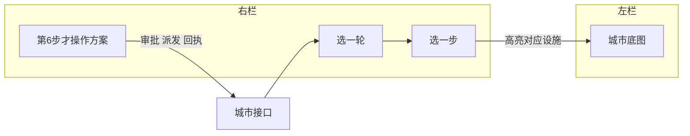

# 城市防汛前端设计说明

日期：2026-10-10。本文描述当前已经实现的决策台页面，文件是 `city_ops/dashboard/index.html`。它由 `city_ops/city_api.py` 在 `http://127.0.0.1:8090/` 直接返回，响应头带 `Cache-Control: no-store`。

这是演示片区的辅助决策界面，不是真实城市 GIS，也不是设备控制台。底图、水深和方案都来自合成快照与规则分析。

## 1. 设计目标

页面要让人在一屏里完成三件事：

1. 看见片区里有哪些设施、水在哪、人和设备在哪。
2. 顺着一轮分析的六步，看每一步得出了什么。
3. 只在最后一步选择方案、记录同意、登记演练和填写现场结果。

前一版把六张卡片、两个方案和审批表单平铺在一页上，步骤和地图没有对应关系，使用顺序不直观。当前版改成和星际争霸决策台相同的左右结构：左边始终是底图，右边是过程。

## 2. 和星际争霸前端的对应

参考实现是 `single_agent_pve/dashboard/`。那里的主工作区是左栏沙盘、右栏态势分析。城市页沿用同一套暗色面板、圆角、顶栏徽章和“点右侧、左侧高亮”的联动，把对局对象换成排水设施。

| 星际争霸决策台 | 城市决策台 | 对应原因 |
|---|---|---|
| 顶栏标题加状态徽章 | 顶栏标题、来源徽章、轮次徽章、再分析按钮 | 先告诉人现在处于什么模式 |
| 左栏“战场态势沙盘” | 左栏“城市底图” | 空间是主视图，不随文字滚动离开 |
| 小地图底图、道路/资源/单位标记 | 示意街区、道路、河道、五类设施点 | 用同一层叠加方式读空间 |
| 右栏“态势分析系统”和阶段切换 | 右栏“每一轮的过程”和六步列表 | 分析是时间上的过程，不是另一张地图 |
| 选中意图或风险时，沙盘上相关单位高亮 | 选中某一步时，相关设施点变大并发光 | 文字和位置互相指向 |
| 刷新分析 | “再分析一轮” | 新开一轮，不覆盖旧轮的阅读入口 |

没有照搬的部分：

- 不使用 Vue，页面是单文件 HTML，样式和脚本都写在 `index.html` 里。
- 不做态势问答、指令队列、特征层、迷雾和映射微调。
- 右侧不用星际争霸那一排模块标签，而用“轮次 + 六步时间线”。城市分析的阅读顺序是固定的六步，轮次之间还要能回看。
- 底图不是游戏截图，而是 `640×640` 的 SVG 示意图。

## 3. 信息架构

```text
顶栏
  标题与一句用法
  来源徽章 | 轮次徽章 | 再分析一轮

左栏 城市底图
  图题与快照摘要
  SVG 底图
  图例

右栏 每一轮的过程
  轮次卡片（新的在上）
    六步
    当前步的说明
    仅第 6 步出现的方案操作
    操作反馈
```

一次只展开正在看的那一轮。其余轮次只留标题，避免几轮的六步叠在一起。



## 4. 视觉系统

视觉直接沿用星际争霸决策台的暗绿战术台，而不是浅色文书页。原因是两边要被看成同一套系统的两种场景：一个看战场，一个看片区。

### 4.1 颜色

| 令牌 | 色值 | 用途 |
|---|---|---|
| `--bg` | `#090f0c` | 页面底色 |
| `--panel` | `rgba(17, 28, 21, 0.9)` | 左右面板 |
| `--line` | `rgba(121, 171, 118, 0.24)` | 面板边、输入框边 |
| `--line-strong` | `rgba(164, 217, 126, 0.4)` | 徽章描边 |
| `--text` | `#edf5e8` | 主文字 |
| `--muted` | `#a8b6a4` | 次要说明 |
| `--accent` | `#b0e36a` | 主按钮、成功反馈、管段 |
| `--warm` | `#f0a55a` | 泵站、高亮光晕 |
| `--danger` | `#ff7a7a` | 失败反馈 |
| `--water` | `#3ec6d6` | 积水、水力连线 |

页面背景还有两层径向光：左上绿色、右上暖色，透明度约 0.16 和 0.12，再叠 `135deg` 的深色渐变。`body::before` 铺 `34px` 的浅网格，并用径向遮罩让网格在画面中央更清楚、四周淡出。网格不接收点击。

面板本身还有一条很淡的自上而下高光，圆角 `24px`，阴影 `0 24px 50px rgba(0,0,0,0.36)`。

### 4.2 字体

- 界面字体：`Bahnschrift`，然后是 `Segoe UI Variable Display`、`Microsoft YaHei UI`、`Segoe UI`。
- 等宽字体变量 `--mono` 已声明为 `Cascadia Code` / `Consolas`，当前页面正文没有用它排数字；水深数字写在 SVG 里，使用 SVG 默认字体。

标题约 `clamp(1.7rem, 2.6vw, 2.5rem)`，字距 `0.02em`。栏目标题 `1.25rem`。说明文字约 `0.82rem` 到 `0.92rem`。

### 4.3 控件

普通按钮是深色胶囊：底 `#070e16` 量级的半透明、细白边、全圆角。主按钮 `.primary` 使用绿色渐变，文字改为 `#12210d`。选中态 `.active` 使用青色描边 `rgba(103, 243, 231, 0.5)` 和深蓝绿底。

来源徽章 `.badge.live` 与主按钮同色，表示“现在看的是演示数据，不是现场控制”。轮次徽章保持深色描边。

## 5. 页面骨架与尺寸

外层 `.page` 最大宽度 `1500px`，左右各留出约 `14px`，上下内边距 `20px` / `24px`。这与星际争霸页 `min(1500px, calc(100vw - 32px))` 的工作台宽度同一量级。

`.workspace` 是两列网格：

- 左列 `minmax(0, 1.2fr)`
- 右列 `minmax(380px, 0.8fr)`
- 列间距 `16px`
- 最小高度 `calc(100vh - 130px)`

左列更宽，因为底图是主视图。右列保底 `380px`，保证六步标题和一行摘要不被挤成竖条。

视口宽度不超过 `980px` 时改成单列：底图在上，过程在下。底图区域最小高度从 `460px` 降到 `380px`。

## 6. 顶栏

从左到右：

| 元素 | 文案或规则 | 作用 |
|---|---|---|
| 主标题 | 城市防汛辅助决策 | 页面名称 |
| 副标题 | 左边看片区，右边看每一轮怎么判断 | 固定用法说明，不随数据变化 |
| 来源徽章 | 快照 `data_source` 为 `synthetic_fixture` 时显示“合成回放”，否则显示 `mode` | 标明数据是合成样例还是其他模式 |
| 轮次徽章 | 无数据时“尚未分析”；有数据时“当前 ”加上 `run_id` 末四位 | 帮人确认正在看哪一轮，不展示整段随机编号 |
| 主按钮 | 再分析一轮 | 用同一份演示样例新跑一轮 |

顶栏左右两端对齐。徽章和按钮允许换行。

## 7. 左栏：城市底图

### 7.1 栏头

标题固定为“城市底图”。右侧摘要 `#map-meta`：

- 还没有分析时：`演示片区`
- 有分析时：`{snapshot_id} · 水深 {最新值} m`
- 有分析但没有水深趋势时：`{snapshot_id} · 无水深`

演示样例的摘要是 `demo-snapshot-001 · 水深 0.18 m`。这里的水深取自计算阶段趋势里最后一个有效点，也就是快照中较新的那次观测，不是预报值。

### 7.2 画布

底图画在 `.map-frame` 里。框体圆角 `18px`，描边 `rgba(176, 227, 106, 0.2)`，底色 `#07110d`。SVG 的 `viewBox` 是 `0 0 640 640`，宽高都铺满画布，比例由浏览器保持。

图是示意图，坐标写死在页面脚本的 `places` 里，没有接真实经纬度。换片区时要改这张底图，不能把节点水深直接画成整片城区的淹没范围。

图层自下而上是：

1. 深色底。
2. 浅绿色参考网格。竖线 `x = 80, 150, 220, 290, 360, 430, 500, 570`，横线同样间距，透明度 `0.35`，描边 `#79ab76`。
3. 三块街区，表示底图上的建成区，不对应具体建筑台账：
   - `(70, 90)` 起，`150×90`
   - `(250, 80)` 起，`130×110`
   - `(430, 100)` 起，`140×80`
   - 填充 `#122018`，描边 `#2c4634`，圆角 `8`
4. 南侧河道：`(80, 470)` 起，`470×90`，填充 `#0c2c33`，描边 `#1d6670`，文字“河道”在 `(96, 522)`。
5. 城市道路：折线 `90,300 → 250,300 → 330,390 → 470,390 → 560,300`，线宽 `28`，颜色 `#314638`，两端圆头。道路在下穿通道处下凹，用来表示通道低于两侧路面。
6. 上游管段：从 L12 到下穿通道的虚线贝塞尔曲线，颜色 `#b0e36a`，线宽 `6`，虚线 `8 6`。
7. 排水方向：从下穿通道到泵站的实线贝塞尔曲线，颜色 `#3ec6d6`，线宽 `6`。
8. 积水范围：椭圆中心 `(330, 390)`，半径 `46×28`，填充 `#0e4f5a`，描边 `#3ec6d6`。椭圆下方有固定文字“积水”。最新水深用白字写在椭圆中心附近 `(292, 394)`。
9. 设施点。

### 7.3 设施点

| 编号 | 图上名称 | 坐标 | 颜色 | 含义 |
|---|---|---|---|---|
| U01 | 下穿通道 | `(330, 390)` | `#3ec6d6` | 积水观测点，落在道路下凹和积水椭圆上 |
| P01 | 泵站 | `(500, 330)` | `#f0a55a` | 排水泵站，位于通道东侧 |
| L12 | 上游管段 | `(150, 230)` | `#b0e36a` | 上游管段，位于通道西北 |
| team-01 | 巡检队 | `(230, 150)` | `#d7e38a` | 可用巡检资源 |
| mobile-pump-01 | 移动泵 | `(520, 170)` | `#c9a27a` | 可用但部署条件未核实的移动排水设备 |

点的标签写在圆心右上方 `18px`、上移 `12px` 的位置，格式是“名称 编号”，例如“下穿通道 U01”。文字颜色 `#edf5e8`，字号 `15`。

未选中的点半径 `11`、不透明度 `0.55`。当前步骤点名的点半径 `16`、不透明度 `1`，并加上 `.hot`：`drop-shadow(0 0 6px rgba(240, 165, 90, 0.95))`。高亮用暖色光，不用红色，避免把“正在看这一步”读成“已经告警”。

管段虚线在 L12 被点中时不透明度为 `1`，否则 `0.45`。通道到泵站的连线在 U01 或 P01 被点中时不透明度为 `1`，否则 `0.4`。这样选步骤时，相关的线会和点一起亮起来。

### 7.4 图例

图例在底图下方，一行排开，窄屏自动换行。五项与上表颜色一致：

- 下穿通道积水
- 泵站
- 管段
- 巡检队
- 移动泵

图例是固定说明，不随步骤隐藏。

### 7.5 步骤如何点亮底图

`focus` 规定每一步点亮哪些编号：

| 步骤 | 点亮 | 为什么 |
|---|---|---|
| 核对数据 | U01、P01、L12 | 这一步检查的是这三处的监测和历史记录 |
| 计算水情 | U01、P01 | 水深发生在通道，故障标志发生在泵站 |
| 核对位置 | U01、P01、L12、team-01、mobile-pump-01 | 这一步同时看水力关系和可用资源 |
| 判断原因 | P01、L12 | 泵故障对应泵站，可能堵塞对应上游管段 |
| 给风险 | U01 | 风险对象是下穿通道 |
| 形成方案 | U01、team-01、mobile-pump-01 | 方案围绕通道防护，并决定是否动用两类资源 |

底图不表达官方预警等级，也不画二维淹没。积水椭圆的大小是固定的，只有中间的数字随最新水深变化。

## 8. 右栏：每一轮的过程

### 8.1 栏头

标题“每一轮的过程”。副文案“点一步，左边标出相关设施”。右栏内容区 `.rounds` 纵向滚动，卡片间距 `12px`。

### 8.2 轮次卡片

接口按创建时间从新到旧返回轮次。页面保持这个顺序，所以最新一轮在最上面。

卡片标题的轮次号用总数减当前位置：列表第一项是“第 N 轮”，最后一项是“第 1 轮”。第一项额外标“当前”，其余标“回看”。正在展开的卡片加 `.current`，边框变成 `rgba(176, 227, 106, 0.35)`。

点轮次标题会重新请求该轮详情，并把阅读位置重置到第 1 步“核对数据”，同时清掉上一条操作反馈。回看不会删除该轮，也不会改当前最新指针。

没有轮次时，右栏只显示“还没有分析轮次。”打开页面时如果列表为空，会先自动调用一次分析，再绘制。

### 8.3 六步

展开的轮次里面是固定顺序：

| 序号 | 内部阶段 | 页面名称 | 一行摘要怎么写 |
|---|---|---|---|
| 1 | `sensing` | 核对数据 | `用了 {监测条数} 条监测，提醒 {告警条数} 项` |
| 2 | `compute` | 计算水情 | 有趋势时 `五分钟上涨 {delta_m} m`；否则“没有够用的水深记录” |
| 3 | `disposition` | 核对位置 | `水力连接 {条数} 条，抢险道路未核实` |
| 4 | `intent` | 判断原因 | 把各假设原文用顿号式分号连起来 |
| 5 | `risk_id` | 给风险 | 固定写“规则没配好，先标成待核验” |
| 6 | `risk_response` | 形成方案 | 有方案时 `待选 {方案编号}`；没有则“没有形成方案” |

某一步在结果里不存在时，摘要写“这一步没有跑”。这发生在快照校验失败、方案生成被暂停的轮次：后面的步骤不会被编造成功。

每一步是一颗左对齐的按钮。左侧是序号，右侧是步骤名和灰色摘要。选中的一步使用 `.active`。点选只改本地的 `state.stage` 并重绘，不重新请求分析。默认进入一轮时停在“核对数据”，让人从第一步看起。

### 8.4 步骤说明

六步下面有一块 `.detail`。标题是当前步骤名，正文按数据拼成白话：

- **核对数据**：把质量提醒的 `message` 连起来。没有提醒时写“这批监测时间对齐，可以接着算。”
- **计算水情**：写上涨速率、趋势说明，以及泵站故障标志是或否。演示数据会得到“观测到的变化是 0.016 m/min”，并保留“不能当作持续线性涨水预测”这句。
- **核对位置**：把水力连接写成 `上游 → 下游`，再附上空间说明。演示连接是 `L12 → U01` 和 `U01 → P01`。
- **判断原因**：每个假设写成“说法：说明”。
- **给风险**：写风险对象、先不划分高低，以及未知项。演示未知项是“当前管段是否堵塞”和“移动抽排部署与排放条件”。
- **形成方案**：固定说明两个方案是二选一，以及三个按钮的先后顺序。

步骤缺失时，说明写成“上游数据有问题，后面的步骤停了。”

### 8.5 方案操作

操作区只在同时满足两点时出现：当前步是“形成方案”，并且这一轮有方案。校验失败的轮次不会出现这组按钮。

控件从左到右、换行排列：

| 控件 | 初始值或选项 | 作用 |
|---|---|---|
| 方案 | `candidate-A`、`candidate-B`，选项文字含方案标题 | 选择要同意或演练的方案 |
| 审批人 | `ops-01` | 审批和派发使用的人员编号 |
| 角色 | `值班长` | 审批角色 |
| 同意这个方案 | 主按钮 | 记录人工同意 |
| 开始演练 | 普通按钮 | 把已同意的方案标成演练派发 |
| 现场结果 | 占位“例如：出入口已拉警戒” | 回执证据，不能空 |
| 任务 | `方案编号 / 任务编号` | 选择要登记结果的任务 |
| 记下现场结果 | 普通按钮 | 提交回执 |

演示方案的含义：

- `candidate-A`：现场防护、检修泵，并核验移动抽排条件。任务 T01、T02、T03。
- `candidate-B`：只做固定设施检修与现场防护。任务 T01、T02。

两个方案是替代关系。页面不把它们画成要同时执行的两套命令。

按钮成功后的反馈：

- 同意：已同意，任务还没派出。
- 演练：演练已登记，还要等现场结果。
- 回执：现场结果已记下。

失败时把接口返回的 `message` 显示为红色。常见情况是没填审批人、还没同意就派发、还没派发就写回执、现场结果为空。

当前回执按钮固定提交 `outcome: "success"`。回执编号是 `{方案编号}-{任务编号}-r1`。同一编号再提交一次会按幂等返回，不会把成功改成失败。页面上还没有失败回执开关。

反馈句放在当前轮次卡片底部。绿色表示成功，红色表示被拒绝。切换轮次或新开一轮时会清掉或换成该动作自己的句子。

## 9. 交互状态

页面内存状态：

```text
runs      轮次摘要列表
detail    当前展开轮次的完整结果
stage     正在看的步骤，初始 sensing
message   最近一条反馈
bad       反馈是否为错误
```

启动：

1. `GET /api/analysis/runs`
2. 若列表为空，`POST /api/analysis/refresh`，再取一次列表。
3. 若列表已有数据，`GET /api/analysis/latest`。
4. 绘制顶栏、底图和轮次。

再分析一轮：

1. `POST /api/analysis/refresh`
2. 重新取轮次列表。
3. 步骤回到“核对数据”。
4. 反馈写成：新的一轮从“核对数据”开始。

点旧轮次：

1. `GET /api/analysis/{run_id}`
2. 步骤回到“核对数据”。
3. 底图改用该轮快照里的水深。演示里各轮快照相同，所以底图数字通常仍是 `0.18 m`，变化主要在右侧步骤和方案状态。

点步骤：只更新 `stage`，底图高亮和说明一起变，不请求服务器。

同意、演练、回执：POST 对应接口。成功时用返回的整轮结果替换 `detail`。列表摘要里的方案状态不会在这次点击后单独刷新；重新进入页面或再分析一轮后，列表会重新获取。

## 10. 接口契约

页面只调用这些接口，都返回 JSON。

| 动作 | 方法与路径 | 页面使用的字段 |
|---|---|---|
| 打开或刷新列表 | `GET /api/analysis/runs?site_id=demo-district` | `runs[].run_id` |
| 最新一轮 | `GET /api/analysis/latest?site_id=demo-district` | 整份结果 |
| 指定一轮 | `GET /api/analysis/{run_id}` | 整份结果 |
| 新跑一轮 | `POST /api/analysis/refresh`，正文 `{}` | 整份结果 |
| 同意方案 | `POST /api/plans/approve` | 返回更新后的整份结果 |
| 开始演练 | `POST /api/plans/dispatch` | 返回更新后的整份结果 |
| 现场结果 | `POST /api/tasks/receipt` | 返回更新后的整份结果 |

站点固定为演示片区 `demo-district`。刷新正文不传站点时，接口默认也是这个片区。

一轮详情里，页面前端实际读取：

- `manifest.run_id`、`manifest.site_id`、`manifest.snapshot_id`、`manifest.data_source`、`manifest.mode`
- `stages.sensing.payload.observation_ids`、`quality_flags[].message`
- `stages.compute.payload.trend.delta_m`、`rate_m_per_min`、`note`、`points` 的最后一点 `value`
- `stages.compute.payload.pump_flags[]`
- `stages.disposition.payload.hydraulic_links[]`、`note`
- `stages.intent.payload.hypotheses[].statement`、`note`
- `stages.risk_id.payload.risks[0].asset_id`、`unknowns`
- `stages.risk_response.payload.plan_ids`
- `plans[].plan_id`、`title`、`tasks[].task_id`

非 2xx 响应读取 `message` 作为红字。网络失败或返回不是 JSON 时，页面显示浏览器给出的错误文本。

## 11. 演示数据在界面上的读法

打开后最新一轮应按这个顺序理解：

1. **核对数据**。三条监测可用。提醒包括移动泵尚未核实部署条件、历史淤积不能证明这次堵塞、没有雨量，以及分级规则还没配置。底图点亮通道、泵站和管段。
2. **计算水情**。五分钟上涨 `0.08 m`，速率 `0.016 m/min`。底图在积水椭圆中写 `0.18 m`，并点亮通道和泵站。
3. **核对位置**。L12 连到 U01，U01 再连到 P01。抢险道路没有单独的路网，所以摘要写未核实。五个点全部点亮。
4. **判断原因**。泵故障有观测支持；管段堵塞只是待核查；降雨负荷证据不足。底图点亮泵站和管段。
5. **给风险**。对象是 U01，等级保持待核验，不写成高或低，也不写成官方预警。底图只点亮通道。
6. **形成方案**。待选 A 和 B。底图点亮通道、巡检队和移动泵。操作按“同意 → 开始演练 → 记下现场结果”进行。

## 12. 空态、阻断和错误

| 情况 | 界面表现 |
|---|---|
| 第一次打开且没有任何轮次 | 自动分析一轮，不要求先点按钮 |
| 列表为空且自动分析也失败 | 顶栏保持“尚未分析”，底图摘要为“演示片区”，反馈为红字 |
| 快照里出现台账没有的设施 | 该轮只有“核对数据”，其余步骤显示“这一步没有跑”，不出现方案按钮 |
| 把合成样例当成实时业务运行 | 接口拒绝，页面不会画出一轮假的实时结果 |
| 未同意就派发、未派发就回执、证据为空 | 按钮下方红字说明原因，底图和已有步骤保留 |

## 13. 实现选择

- 单页、无构建、无前端框架。重绘方式是清空容器后用 DOM 方法重建，方案文字用 `textContent` 写入，避免把接口字符串当成 HTML。
- 底图的街区、道路、河道和连线使用 SVG 片段字符串插入；设施点用 SVG 元素逐个创建。
- 服务端不单独托管 CSS 或 JS。修改 `city_ops/dashboard/index.html` 后，刷新浏览器即可看到，因为页面响应禁止缓存。
- 改接口代码后需要重启 `python -m city_ops.city_api`。只改 HTML 不必重启。

## 14. 当前边界

这些能力还没有做进这版界面，后续若扩展，应继续保持“左图右过程”：

- 底图坐标来自手写示意图，不来自资产台账里的地理字段，也不能缩放、拖拽或切换真实地图。
- 积水椭圆不随水深缩放，水深只显示为一个数字。
- 右栏不展示仿真峰值、退水时间和模型版本；这些字段在数据里是空的，页面只用第 6 步的文字说明方案尚未推演。
- 回执只有成功一种结果，没有失败按钮，也没有按任务显示已回执状态。
- 同意和演练之后，方案卡片上的摘要不会改写成“已审批”或“已派发”；状态变化靠反馈句和再次请求详情体现。
- 不提供态势问答、多片区切换、历史雨量曲线和二维淹没动画。
- 不调用大模型改写步骤文案。摘要和说明都由页面按字段拼接。

后续若接入真实底图，左栏仍应只显示有坐标、有台账的设施；未知影响继续留在右侧文字里，不要补画到地图上。
