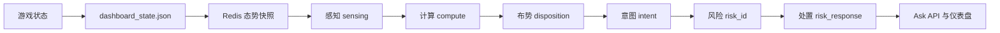
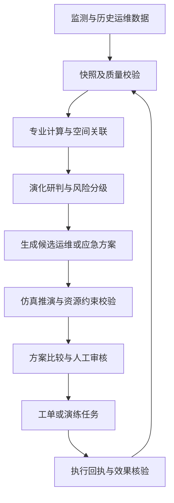

# 智慧城市技术与创意设计：SwarmBrain 复用分析与修改示例

日期：2026-10-09。本文基于本地代码与文档静态阅读，提供迁移设计；未启动游戏、调用模型或接入真实市政设备。以下城市功能是拟议方案，场景数据是演示假设，均不代表已实现或已验证。

建议项目定位：**面向排水管网隐患治理与暴雨内涝的多智能体辅助决策系统**。选择一个片区，贯通日常运维、事件研判、方案推演、应急调度与事后复盘。

## 1. 原工程实际做了什么

### 1.1 目录与选用基座

| 目录 | 当前用途 | 迁移取舍 |
|---|---|---|
| `single_agent_pve/` | 一个 SwarmBrain Bot 对抗电脑或人类；包含游戏执行、仪表盘、Ask API、Redis 工具和分析流水线 | 优先参考这里的数据流和六阶段分析代码 |
| `multi_agent_duel/` | 红蓝两个 Bot 对抗，并有双侧分析 | 可参考命名空间隔离与情景比较；第一版无需双 Bot |
| `single_agent_pve_selfplay/` | README_SELFPLAY 说明增加“我方草案→预测对手→反思→收敛”的提示词流程 | 可迁移为候选方案与失效情景审查；仅凭此流程不能声称模型学习或能力持续提升 |
| `mass/` | README 描述人机入口；分析编排已经采用分层并发 | 暂不选作直接复制基座，需先核对阶段依赖 |
| `new_agents/` | 子智能体工厂、配置示例、数据契约和离线样例 | 适合参考角色配置和结构化输入输出规范 |
| `dist/` | 历史部署快照 | 不作为当前代码权威入口 |

根 README 指向模式目录开发。根目录残留的 `run_sc2_deerflow_pipeline.py` 包含异常文本 `import re121】`，并引用根目录不存在的运行模块，因此应从模式目录选取参考代码，而非直接复制根入口。部分 `new_agents` 文档仍描述根目录运行，迁移时需以实际模式代码为准。

### 1.2 两条决策路径

**路径 A：驱动游戏的 Overmind。**

`swarmbrain_launch.py` 在 `on_step()` 读取游戏状态，持续执行工人分配、单位反应和生产等规则，同时按迭代间隔异步触发宏观、建筑与进攻决策。`swarmbrain.py` 构造提示词并调用模型。返回的 `(单位, 地点)->(动作)->(目标)` 文本经过解析、过滤与排队，再由游戏执行函数处理。上一轮指令和最新状态会进入后续决策，日志记录模型调用和命令事件。

可迁移思想：**规则承担快速且稳定的操作，大模型承担较慢的综合分析与计划，状态变化触发重新评估。** 城市版可让设备本地控制承担实时保护，让大模型辅助跨设施、跨部门的计划制定。

**路径 B：仪表盘触发的分阶段态势分析。**



其中，bridge 把状态整理成 `situation:current` 及分层数据；各阶段读取上游缓存，通过工具调用写入 `sc2:analysis:{thread_id}:{stage}`；编排器绑定模型与工具，限制推理轮数和超时，并尝试补写可解析的 JSON。`/api/risk/refresh` 调起分析，读取阶段产物返回前端。

这里的“多智能体”主要指同一个模型配置下的多个职责与工具配置，并不要求训练多个独立模型。代码采用 DeerFlow 风格配置与本地编排，不能直接据此称为完整官方 DeerFlow 平台。

两条路径需要区分：游戏正在执行的 Overmind 指令，并不等同于六阶段 `risk_response` 已经闭环执行。`sc2_send_commands()` 可将命令写入 Redis，但其成功返回仅表示排队；本次静态阅读没有确认这条 Redis 队列到游戏执行结果的完整链路。

### 1.3 具体参考文件

| 代码入口 | 已读到的作用 | 城市版对应文件 |
|---|---|---|
| `single_agent_pve/dashboard_to_redis_bridge.py`，`build_situation()` | 把游戏状态归一化为事实快照 | `city_data_adapter.py` |
| `single_agent_pve/sc2_agents.py` | 六阶段角色、提示词、工具与输出格式 | `city_agents.py` |
| `single_agent_pve/run_sc2_deerflow_pipeline.py` | 顺序编排、工具调用、超时和缓存补写 | `run_city_pipeline.py` |
| `single_agent_pve/sc2_redis_tools.py` | 态势读取、缓存读写、属性查询、趋势和命令队列 | `city_tools.py` |
| `new_agents/create_new_agent.py` | 配置工厂 | 改为可配置领域前缀、工具名和显式缓存键的通用工厂 |
| `single_agent_pve/ask_api_server.py` | 问答、分析刷新、方案接口 | `city_api.py` |
| `single_agent_pve/dashboard/` | 地图联动、分析卡片、方案与消息展示 | 城市地图、风险卡片、方案比较、任务回执界面 |
| `single_agent_pve/swarmbrain_run_logger.py` | run、模型调用、命令批次与事件日志 | 决策、任务、回执与复盘记录 |

## 2. 与赛题要求的对应

| 赛题要求 | 拟议功能 | 可交付证据 |
|---|---|---|
| 隐患数据分析 | 汇总历史积水、清淤、故障、巡检与实时监测；识别重复故障、数据异常和待核查点 | 数据字典、质量报告、隐患清单与来源 |
| 风险研判分级 | 计算水位趋势与超限情况，结合管网关系、重点设施和受影响对象分级 | 风险清单、触发规则、证据与不确定性 |
| 智能运维方案设计 | 日常巡检、清淤、设备检修与汛前资源预置的优先级和工单 | 运维计划、资源需求、成本依据与验收条件 |
| 应急处置流程规划 | 明确任务主体、依赖、时间、备用动作及升级条件 | 任务流程、审批记录、演练回执 |
| 落地可行性论证 | 给出数据获取、人员职责、设备接口、维护成本和分阶段接入方案 | 接口说明、试点范围、预算清单与效果评估 |

建议先做“一个片区的排水管网与易涝点”，后续扩展到给水泄漏、地下管线或公共空间。不同场景可共用编排、审计和工单流程，但需要各自的数据契约、专业计算模型和处置规则。

## 3. 六阶段怎么改

| 原阶段 | 城市版阶段 | 输入与主要输出 | 实现重点 |
|---|---|---|---|
| 感知 sensing | 数据接入与质量检查 | 雨量、水位、流量、泵状态、巡检→同一时点快照、缺失与过期标记 | 单位转换、时间对齐和质量检查用程序实现 |
| 计算 compute | 水情与设施指标计算 | 快照与设施参数→涨水速度、负荷、超限、模型预测 | 程序或专业模型计算，大模型调用工具并解释 |
| 布势 disposition | 空间关联与资源分析 | 管网拓扑、位置、道路状态、队伍→上下游关联、暴露对象、可用资源与路线 | 水力连接和抢险道路连接分别建模；空间邻近不等于因果联系 |
| 意图 intent | 风险演化与原因研判 | 时间序列、拓扑、历史事件→可能原因、演化情景和待验证证据 | 对自然灾害研判演化，不沿用敌我与进攻防御标签 |
| 风险 risk_id | 风险分级与处置排序 | 预测、暴露和规则→分级、排序、证据、影响范围 | 区分风险高低与证据充分程度；未知不能自动归为低风险 |
| 处置 risk_response | 运维与应急计划 | 风险、资源、有效预案→候选方案、任务依赖、责任与验收 | 增加方案推演、约束校验、审批和回执 |

**推荐的流程增量**：沿用六阶段主线，把处置阶段扩为“生成候选方案→调用仿真与资源校验→选择或修正方案”。其后接独立的工单与执行状态机，再将结果反馈为下一轮快照。



## 4. 一个完整修改示例：暴雨期间下穿通道积水

### 4.1 演示输入

假设片区内有下穿通道 U01、关联排水泵站 P01、上游管段 L12；有一支巡检队和一台移动排水设备。假设已有经核验的设施关联关系。以下数值仅用于说明输入契约，不是预警标准。

```json
{
  "schema_version": "city_snapshot_v0.1",
  "snapshot_id": "demo-snapshot-001",
  "event_id": "demo-rain-001",
  "observed_at": "2026-10-09T14:00:00+08:00",
  "data_source": "synthetic_fixture",
  "observations": [
    {"id": "obs-depth-now", "asset_id": "U01", "metric": "water_depth", "value": 0.18, "unit": "m", "quality": "valid", "observed_at": "2026-10-09T14:00:00+08:00"},
    {"id": "obs-depth-prev", "asset_id": "U01", "metric": "water_depth", "value": 0.10, "unit": "m", "quality": "valid", "observed_at": "2026-10-09T13:55:00+08:00"},
    {"id": "obs-pump", "asset_id": "P01", "metric": "pump_fault", "value": true, "quality": "valid", "observed_at": "2026-10-09T14:00:00+08:00"}
  ],
  "historical_findings": [
    {"record_id": "inspection-L12", "asset_id": "L12", "finding": "历史巡检记录过淤积，本次是否堵塞待核查"}
  ],
  "resources": [
    {"resource_id": "team-01", "type": "inspection_team", "available": true},
    {"resource_id": "mobile-pump-01", "type": "mobile_pump", "available": true, "deployment_feasibility": "unverified"}
  ]
}
```

### 4.2 六阶段应产生什么

1. **感知**：核对数据来源和时间，确认水深与设备故障属于同一决策快照；标记移动设备部署可行性尚未核实。
2. **计算**：程序计算五分钟上涨 0.08 m，即 0.016 m/min。该观测趋势不能直接当作持续线性涨水预测；短期演化需结合降雨、排水能力与模型。
3. **空间分析**：核对 U01 与 P01、L12 的水力关系，查受影响出入口与敏感设施；核实队伍路线、移动设备作业点、供电、排水去向与接管条件。
4. **演化研判**：列出“泵故障造成排水能力下降”“可能存在管段堵塞”“降雨负荷超过能力”等假设，分别标注证据。历史淤积只能支持待核查假设，不能证明本次堵塞。
5. **风险分级**：按试点配置的规则及有效预案分级，列出上涨趋势、设备故障和暴露对象。项目内部等级须与官方预警、应急响应等级分开命名；规则不足时输出待核验状态。
6. **方案设计**：生成“固定设施检修与现场防护”“满足部署条件后增加移动抽排”等方案，进行仿真与资源比较，再生成供授权人员审核的任务单。

### 4.3 方案输出示例

下面是一份**待推演、待审批的结构示例**，不是现场操作建议。任务责任角色以试点确认的预案为准。

```json
{
  "schema_version": "city_plan_v0.1",
  "run_id": "demo-analysis-001",
  "snapshot_id": "demo-snapshot-001",
  "event_id": "demo-rain-001",
  "mode": "simulation",
  "plan_id": "candidate-A",
  "risk": {
    "asset_id": "U01",
    "project_level": "pending_rule_validation",
    "evidence_ids": ["obs-depth-now", "obs-depth-prev", "obs-pump"],
    "unknowns": ["当前管段是否堵塞", "移动抽排部署与排放条件"]
  },
  "tasks": [
    {"task_id": "T01", "action": "verify_site_and_protection", "owner_role": "现场管理责任单位", "depends_on": [], "completion_check": "现场状态与人员车辆防护措施有回执"},
    {"task_id": "T02", "action": "inspect_pump_fault", "owner_role": "排水设施运维单位", "depends_on": [], "completion_check": "故障原因和设备可用性已确认"},
    {"task_id": "T03", "action": "evaluate_mobile_pump_deployment", "owner_role": "应急抢险责任单位", "depends_on": ["T01"], "completion_check": "路线、作业点、供电与排放条件完成核验"}
  ],
  "simulation": {"status": "not_run", "model_version": null, "peak_depth_m": null, "recovery_time_min": null},
  "approval": {"status": "pending", "approved_by": null},
  "execution": {"status": "not_dispatched", "receipts": []}
}
```

正式任务还应包含开始时间、期限、设备与人力需求、动作前置条件、异常升级和完成证据。设备参数及操作许可由程序校验，不能由模型自由补全。

### 4.4 如何比较方案

固定同一降雨输入、初始水位、设备状态和资源预算，比较：现有规则方案、模型生成方案、经仿真修正的方案。记录预测峰值、积水持续时间、受影响范围、设备能耗、人员与任务可达性。未建模的影响标为未知，不用大模型臆造结果。

可选 EPA SWMM 作为排水模型底座。其官方资料确认支持降雨径流、管网水力、泵及调蓄设施、顶托与超载等模拟，也支持控制规则；具体片区还需设施参数、边界条件及实测数据校准。[EPA SWMM 官方说明](https://www.epa.gov/water-research/storm-water-management-model-swmm)

第一版可做管网与节点级推演。若要展示道路表面二维淹没范围、车辆通行或人群暴露，需要另加相应数据与模型；不能由节点水位直接推出整片城区二维积水图。数字孪生应体现“设施映射、状态同步、模型校准与方案推演”，地图或三维展示只是其中的界面。

### 4.5 日常运维怎么接上

雨前：根据重复积水、故障、巡检与检修记录，安排核查、清淤、设备检修和资源预置；优先级依据重复性、关键程度、暴露和资源约束，形成可验收工单。

雨中：上述六阶段进行事件研判与滚动方案更新。

雨后：核对恢复情况与实际回执，检查原判断是否成立；将发现的缺陷、未完成维修和模型误差转入下一轮维护计划。模型参数或规则更新应有审核与版本记录，不能直接把一次模型反思当作训练结果。

城市内涝治理的官方文件强调监测感知、设施运维、抢险资源和部门协同等需要，可作为项目业务覆盖的依据；具体阈值、职责与响应程序需采用试点所在地有效预案。[国务院办公厅关于加强城市内涝治理的实施意见](https://www.beijing.gov.cn/zhengce/gwywj/202104/t20210426_2373347.html)

## 5. 代码层的最小迁移方向

建议新建独立 `city_ops/`，保留原 SC2 作为参考。下表和目录均是拟议结构，本次未创建运行系统。

```text
city_ops/
  city_data_adapter.py        # 文件回放、传感器或数据库输入的归一化
  city_agents.py              # 六阶段城市角色配置
  city_tools.py               # 快照、资产、预案、仿真与工单工具
  run_city_pipeline.py        # 保持阶段依赖的编排
  city_api.py                 # 分析、方案比较、审批与回执接口
  schemas/                   # 快照、风险、方案与任务的数据契约
  fixtures/                  # 合成演示与标注事件
  simulation/                # SWMM 适配，记录参数和模型版本
  dashboard/                 # 地图、风险、方案和任务闭环
```

| 原机制 | 建议修改 |
|---|---|
| `situation:current` | `city:situation:{site_id}:current`，由程序冻结带 `snapshot_id` 的本轮快照 |
| `sc2:analysis:{thread_id}:{stage}` | `city:analysis:{site_id}:{run_id}:{stage}`，区分事件 ID、分析轮次与快照 ID |
| `sc2_get_situation/layer` | 城市快照读取；图层为设施、监测、管网、暴露对象与资源 |
| `sc2_unit_capabilities` 静态单位表 | 资产能力、设备曲线、维护要求及有效预案检索 |
| `sc2_get_trend` | 带观测时间和质量标记的真实时间窗序列，不能直接复制“上次调用锚点差值” |
| `sc2_send_commands` | 提交待审核任务；实际设备动作由独立授权执行服务处理 |
| 三元文本命令解析 | 类型明确的任务 JSON，引用真实资产、资源和责任角色 |
| `replay/live` | 城市版明确区分历史回放、仿真演练和业务运行；历史回放与未来情景推演是不同工具 |
| 原仪表盘敌我与意图维度 | 资产、风险、演化、资源、方案比较、任务回执；数据来源和缺失情况可查看 |

### 必须补齐的程序约束

- **完整性与类型校验**：原缓存 `cache_set` 主要检查 JSON 可解析。城市版检查字段、单位、枚举、资产存在性、来源、快照一致性及跨字段约束；关键上游缺失时保留事实和确定性告警，暂停依赖这些输入的方案生成。
- **真实审批**：原处置提示词要求人工确认，但 `sc2_send_commands` 本身只检查数量与动作类型，没有审批凭证校验。城市版的执行接口须验证审批人权限、审批绑定的方案版本、时效和设备条件；提示词中的 `approved=true` 不可充当审批凭证。
- **队列与完成状态**：分别记录建议、待审批、已审批、已派发、执行中、成功、失败和取消；工单或设备回执到达后才更新状态，排队成功不能显示任务已完成。加入幂等任务 ID 和重复提交检查。
- **计算与模型分工**：涨水速度、能力、调度约束及风险规则由程序或专业模型执行；大模型做证据组织、原因假设、候选方案与解释。未经校准的模型置信度不能当成真实发生概率。
- **依赖与超时**：原顺序版超时后仍可能继续下游。新编排器应显式检查必需上游；`mass` 中 compute 与 disposition 并发，但 disposition 配置依赖 compute，不能原样迁移这组并发关系。
- **审计保存**：Redis 可保留短期快照与分析缓存；决策依据、规则和预案版本、仿真输入输出、审批及回执应另行持久化，不依赖一小时 TTL 缓存。

## 6. 可检验的创新点

推荐主张：**监测证据与机理模型约束下的多智能体城市运维决策，能够生成可追溯、可推演、资源可行的处置方案，并结合回执滚动修正。** 这是待验证的项目主张。

从原“反思”流程迁移的具体做法：先生成候选计划，再注入泵故障、道路不可达、传感器缺失或降雨偏差等情景；调用模型与约束检查比较效果；审查角色依据结果指出缺陷；计划角色修正并保留修正原因。这属于情景推演与方案审查，第一版不需要开展大模型训练。

验证建议：

| 对照 | 用于回答的问题 |
|---|---|
| 规则阈值与固定预案 | 是否比已有基础方法更有帮助 |
| 单大模型，相同数据与工具 | 分阶段角色组织是否有增益 |
| 六阶段，但去掉方案仿真 | 仿真校验是否减少无效或有副作用的方案 |
| 六阶段 + 仿真约束 + 回执 | 完整流程是否改善资源可行性和恢复表现 |

对照使用相同事件输入、工具条件和预算，记录端到端时延、模型调用成本与仿真开销。风险评价需要专家标注或明确参照；仿真评价只能支持模型内结果，真实可行性还要现场演练或业务试点。

指标包括风险漏报和误报、风险发现提前量、无依据判断比例、不可执行任务比例、资源冲突、关键设施恢复时间、决策时延与成本。资源不足、传感器故障、异常工况须纳入留出测试；预案/阈值调优不能使用同一组测试事件。

## 7. 最小落地顺序与竞赛展示

1. **离线原型**：选一个片区，提供资产台账、拓扑和合成监测样例；沿用六阶段组织，输出证据明确的风险卡片与待审核任务。界面明确合成、回放、预测与实时来源。
2. **可比较的推演**：建立并检查一个小型 SWMM 模型，对多个候选方案在同一事件下运行；展示参数、运行结果和未覆盖影响。合成模型只用于验证流程。
3. **业务闭环验证**：导入真实历史记录并校准；与运维人员核对责任、流程和资源；先开展工单演练，再根据试点授权范围接入执行服务。

预算论证至少列数据整理与授权、传感器和通信（按已有/新增区分）、模型校准、软件部署、模型调用、人员培训和日常维护。获得现场条件与报价后填入金额，不预先编造成本或收益比例。

演示可围绕一场事件展开：雨前隐患工单→雨中监测变化→风险证据→两种处置方案推演→审核与派发演练→失败回执触发修正→雨后转入维护计划。展示重点是辅助决策的依据、方案效果和任务闭环。

本次交付仅为分析与修改方向。原运行代码保持原状，城市数据适配、专业模型与上述接口均待实现。
