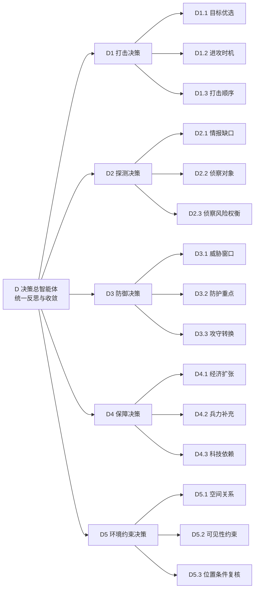
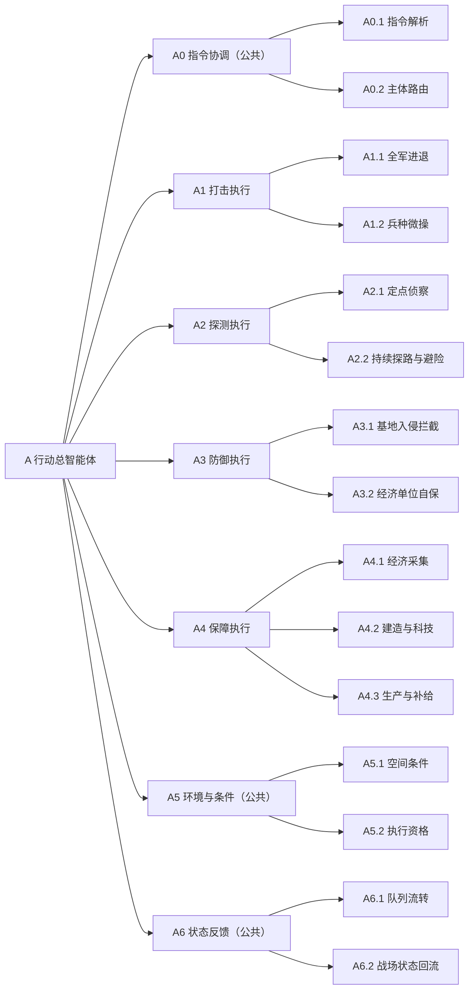

# D 五维自博弈决策与 A 行动智能体

> `single_agent_pve_selfplay` 业务汇报 PPT 制作指导 · 树状架构版 · 12 页  
> 日期：2026-10-31  
> 本版主线：**先讲 D 有哪些智能体与子智能体，再逐维讲清自博弈；随后画 A 的智能体树，再展开每类执行职责。**

本版用“打、探、防、保、环”统一表示 **打击、探测、防御、保障、环境**。OODA 保留为总框架，观察与研判作为 D 的输入背景，不再单独占用多页。

**读图约定：**下文的“五维子智能体”是围绕当前功能组织的**业务职责树**，用来说明有哪些决策职责、各自做什么。当前 D 的核心由 Overmind 的宏观、建筑、进攻判断等调用及四步提示协议承载，并没有独立部署下面命名的 15 个决策子智能体。A 的子智能体同样是对现有规则函数、指令处理与游戏动作的职责归纳。图中名称可以直接用于业务汇报，讲解时保留“逻辑架构”标注。

前端与代码的对应关系、限制和素材来源集中放在制作备注及附录中。正式 PPT 重点展示职责、过程和界面证据。

---

## 第 01 页｜D 决策智能体：五维决策树

### 1. 页面主旨

**D 在五维下共同审视一轮方案：既考虑如何打击，也考虑情报、防御、持续保障和环境条件。**

页顶只放一条小型 OODA 导航：

> O₁ 观察 → O₂ 研判 → **D 五维自博弈决策** → A 行动 → 新态势

### 2. 先画这棵树

```text
D 决策总智能体
│  统一提出方案、预测对手、反思纠偏、收敛输出
│
├─ D1 打击决策智能体
│  ├─ D1.1 目标优选子智能体
│  ├─ D1.2 进攻时机子智能体
│  └─ D1.3 打击顺序子智能体
│
├─ D2 探测决策智能体
│  ├─ D2.1 情报缺口子智能体
│  ├─ D2.2 侦察对象子智能体
│  └─ D2.3 侦察风险权衡子智能体
│
├─ D3 防御决策智能体
│  ├─ D3.1 威胁窗口子智能体
│  ├─ D3.2 防护重点子智能体
│  └─ D3.3 攻守转换子智能体
│
├─ D4 保障决策智能体
│  ├─ D4.1 经济扩张子智能体
│  ├─ D4.2 兵力补充子智能体
│  └─ D4.3 科技依赖子智能体
│
└─ D5 环境约束决策智能体
   ├─ D5.1 空间关系子智能体
   ├─ D5.2 可见性约束子智能体
   └─ D5.3 位置条件复核子智能体
```

**图下结论：**五维是同一轮决策的不同职责视角，由 D 总智能体统一权衡并输出本轮方案。

### 3. 五个分支各负责什么

| 分支 | 必须回答的问题 | 面向行动的产出 |
|---|---|---|
| 打击 | 打谁、何时打、按什么顺序打？ | 目标、优先级、出击或等待判断 |
| 探测 | 哪些情报缺失，先确认什么？ | 侦察需求、优先方向、行动前提 |
| 防御 | 对手会威胁哪里，哪些对象要先保护？ | 防护重点、回防与攻守转换安排 |
| 保障 | 先发展、补兵还是补科技？ | 扩张、生产与建设顺序 |
| 环境 | 当前地点、空间与视野是否支持方案？ | 地点约束、未知条件和待执行核验事项 |

### 4. PPT 怎么画

- 顶层 D 总智能体占页面上方中心，下面排五个分支，再向下展开各自三个子智能体。
- 五维名称用大字；叶节点短写为“目标优选、进攻时机、打击顺序”等，详细解释留到第 03–07 页。
- 环境分支在树上保留，图底增加贯穿四个能力分支的细线：“空间 / 视野 / 位置约束”。
- 图角标注“业务职责分解”。本页不放大段源码或多个前端缩略图。

### 5. 讲解稿

“先看 D 的结构。决策不是只回答打不打，而是要同时处理打击、探测、防御、保障和环境五个方面。每个方面进一步拆成具体职责：例如打击要考虑目标、时机和顺序，保障要考虑扩张、补兵和科技。树中的子智能体表示业务分工，当前由统一决策过程和相关辅助分析承载。接下来逐维说明，它们怎样利用对手反应修正我方方案。”

---

## 第 02 页｜五维共用的自博弈方法：四步纠偏，一次收敛

### 1. 页面主旨

**自博弈体现在“我方方案与对手反应相互检验”，最终必须明确改了什么。**

### 2. 可直接放入 PPT 的流程

```text
当前态势与已探测敌情
         │
         ▼
① 我方草案：本窗口原本准备怎么做？
         │
         ▼
② 对手预测：对手最可能怎样应对，大致在何时？
         │
         ▼
③ 矛盾纠偏：原方案哪里会被反制？删什么、缓什么、加什么？
         │
         ▼
④ 收敛输出：给出修正后的方案、命令或进攻判断
```

### 3. 各子智能体如何参与四步

以打击维为例，三个子职责并不是三次互不相关的问答：

- **目标优选**提供当前想打的对象及理由。
- **进攻时机**比较立即投入与继续等待，并考虑对手的应对窗口。
- **打击顺序**结合前两项修正行动先后，形成有条件的推进安排。
- D 总智能体综合其他维度，收敛成一份当前窗口方案。

同样的逻辑用于探测、防御、保障和环境。**以下五页是对同一四步机制的分维讲解，不代表代码已经分别执行五次模型调用，再投票汇总。**

### 4. 输入、纠偏证据与输出

| 位置 | 应展示的内容 | 前端载体 |
|---|---|---|
| 输入 | 时间、我方单位/建筑/科技、已探测敌方单位/建筑及地点信息 | 态势感知、兵力布势、方案生成的脚本输入/摘要 |
| 过程 | 我方草案、对手预测、具体矛盾 | 作战方案生成 → 方案生成智能体 |
| 纠偏证据 | 删除、延后、新增，以及对应理由 | 同一轮回复中的反思纠正段 |
| 输出 | `(主体, 地点)->(动作)->(目标)`，或进攻/等待判断 | 方案回复与指令解析 |

### 5. 必须突出的关键句

> **自博弈的可见结果，是方案经过对手视角检验后发生了有理由的变化。**

### 6. PPT 与取图指导

- 左边放四步图，第三步用橙色突出；右边放同一轮四步回复，框出“删、缓、加”。
- 使用①②③④编号。源码协议中的 A/B/C/D 只是四步标题，PPT 不使用这些字母作为大号编号，以免与 OODA 的 A、D 混淆。
- 所谓“思维链”在这里指显式输出的分析文本，不宣称展示了模型内部全部推理。
- 该协议用于宏观、建筑和进攻时机等决策入口；建议 API 的回复不当然具有同样的四步格式。

### 7. 讲解稿

“五维共用一套四步机制。第一步提出我方原方案；第二步只根据当前可见情报预测对手；第三步检查原方案与对手反应之间的矛盾，明确删除、延后或增加什么；第四步输出修正结果。我们不是看文字有多长，而是看方案是否发生了可以解释的改变。下面按五个维度，把这种改变具体展开。”

---

## 第 03 页｜打击维：目标、时机与顺序怎样进行自博弈

### 1. 本页的小树

```text
D1 打击决策智能体
├─ D1.1 目标优选：首要与备选目标是什么？
├─ D1.2 进攻时机：现在打还是等待条件？
└─ D1.3 打击顺序：先确认、压制还是投入主力？
```

### 2. 每个子智能体的细节

| 子智能体 | 输入 | 主要工作 | 输出 | 对应前端 |
|---|---|---|---|---|
| 目标优选 | 可见敌方单位、建筑、地点；辅助目标清单 | 比较经济、科技、防御和作战目标的意义，审阅优先级 | 首要/备选目标与选择理由 | 关键打击节点、打击建议、沙盘瞄准标记 |
| 进攻时机 | 双方兵力与火力估计、发展阶段、敌方设防情况 | 比较现在攻击与继续准备；预测对手如何防守或反击 | 进攻、暂缓及其原因 | 方案生成中的 Attack Decision；兵力布势与风险作参考 |
| 打击顺序 | 候选目标、部署位置、建议链路和情报条件 | 解释先后依赖，区分先确认、局部试探与主力投入 | 本轮优先行动及后续行动前提 | 杀伤链作战模式、敌链破坏步骤流、方案回复 |

### 3. 打击维的四步自博弈

| 步骤 | 应讲的具体内容 |
|---|---|
| ① 我方草案 | 我方已有地面战力，准备立即突破敌方前沿设防区域。 |
| ② 对手预测 | 对手可能依托现有防线固守，利用防御火力消耗我方，并继续转型。 |
| ③ 矛盾纠偏 | 目标仍有价值，但“现在正面全压”可能损失过大。删除立即总攻，增加前沿部署与有限试探，延后主力投入。 |
| ④ 收敛输出 | 形成暂缓总攻、准备与局部接触的方案；进攻判断路径再输出出击或等待结论。 |

**自博弈变化：**“看见目标就打”转为“根据对手反应重新选择时机与承诺强度”。

### 4. 前端怎么展示

推荐从三处各取一个可读区域：

1. **关键节点**：展示目标及其位置，回答“打谁”。
2. **杀伤链**：展示建议步骤流，回答“先后怎么安排”。
3. **方案生成**：展示四步与最终进攻结论，回答“为何改变”。

目标建议、链路建议使用虚线连接到人员审阅/辅助判断；不要画成点击节点就自动开火。实际进攻控制依据真实决策路径与动作逻辑。

### 5. 素材与讲解稿

可使用目录内历史 `Building Planner` 回复：记录时间 `2026-09-18T10:21:04`，回复中游戏时刻为 `14:50`。该回复确实呈现“立即强攻→放弃立即总攻、补经济与前沿部署”的纠偏。页面标注“历史模型输出转述”，不把预测写成敌人的实际后续行为。

“打击维要同时处理目标、时机和顺序。历史回复里，最初方案是立即突破前沿；对手预测却表明敌人可能依托防线持续消耗。于是模型保留目标方向，但改变投入方式：取消立即总攻，先准备并试探。打击自博弈的重点，是在对手反应之后重新判断这一轮该投入多少、何时投入。”

---

## 第 04 页｜探测维：信息不足时怎样避免过度承诺

### 1. 本页的小树

```text
D2 探测决策智能体
├─ D2.1 情报缺口：哪些判断缺少依据？
├─ D2.2 侦察对象：先确认主力、扩张还是科技？
└─ D2.3 侦察风险权衡：信息收益是否值得承担暴露风险？
```

### 2. 每个子智能体的细节

| 子智能体 | 输入 | 主要工作 | 输出 | 对应前端 |
|---|---|---|---|---|
| 情报缺口 | 已探测敌军、敌方建筑、前端视野与迷雾 | 区分已知、推测与未知；提示“未发现”不能直接当作“没有” | 需要补充确认的情报项目 | 态势感知、可见敌情列表、迷雾沙盘 |
| 侦察对象 | 待确认事项、已知科技与扩张迹象、地点关系 | 比较确认主力位置、分矿或科技路线对当前决策的影响 | 优先侦察对象及方向 | 探测类布势、沙盘地点、方案中的侦察建议 |
| 侦察风险权衡 | 侦察单位位置、已知敌方威胁、关键判断缺口 | 对比深入侦察的收益与损失风险，限制主力在未知条件下的投入 | 侦察前提、较谨慎的行动建议 | 探测风险、探测单位、方案反思文本 |

### 3. 探测维的四步自博弈

| 步骤 | 统一场景下的机制示例 |
|---|---|
| ① 我方草案 | 只看到少量敌军，拟把主力投入该接触方向。 |
| ② 对手预测 | 对手可能隐藏主力、转向另一矿点，也可能利用少量单位吸引注意。 |
| ③ 矛盾纠偏 | “当前可见敌军较少”不能支持“该方向整体安全”。降低立即投入强度，优先确认主力与关键方向。 |
| ④ 收敛输出 | 形成侦察对象、待确认条件与条件性行动建议；在信息不充分时暂缓高承诺行动。 |

**自博弈变化：**“依据局部可见信息直接行动”转为“考虑对手利用信息差的可能性，再决定先探还是先打”。

### 4. 前端怎么展示

- 左侧放带迷雾的沙盘，标“当前可见”“待确认方向”。
- 右侧上方放探测单位布势，下方放方案回复中的对手预测与补情报建议。
- 一根细箭头从“待确认方向”返回“进攻时机”，说明侦察影响打击决策。
- “待确认方向”是本次讲解标注，不把它冒充已有的自动盲区推荐控件。

### 5. 与 A 的衔接

探测决策给出的是“需要什么信息”；探测执行负责“已有规则和可用任务如何获得信息”。当前宏观/建筑命令过滤包含 `Overlord`、`Move` 等关键词，所以不能宣称每条模型侦察建议都会自动变成王虫侦察命令。运行中的王虫探路与避险还由既有规则持续承担。

### 6. 讲解稿

“探测维的自博弈，是把对手利用信息差的可能性纳入判断。少量敌军可能意味着薄弱，也可能意味着主力尚未暴露。情报缺口子智能体先指出依据不足，侦察对象子智能体明确先确认什么，风险权衡再考虑如何避免侦察损失。最终改变的既可能是侦察方向，也可能是打击决策的承诺程度。”

---

## 第 05 页｜防御维：保护对象与攻守转换怎样进行自博弈

### 1. 本页的小树

```text
D3 防御决策智能体
├─ D3.1 威胁窗口：敌方可能何时、从何处施压？
├─ D3.2 防护重点：主矿、分矿、工人、关键建筑先保谁？
└─ D3.3 攻守转换：继续推进、收拢、回防还是补防？
```

### 2. 每个子智能体的细节

| 子智能体 | 输入 | 主要工作 | 输出 | 对应前端 |
|---|---|---|---|---|
| 威胁窗口 | 可见敌军、敌方生产科技迹象、双方阶段与位置 | 预测对手何时可能前压，以及我方发展窗口是否暴露 | 威胁方向与时机假设 | 意图识别、防御风险、模型对手预测 |
| 防护重点 | 基地、工人、关键建筑、当前守军分布 | 比较被威胁对象及损失影响，审阅重点保护位置 | 保护对象与优先级 | 沙盘、布势明细、风险点及防御任务 |
| 攻守转换 | 打击方案、回防位置、防御缺口和可用单位 | 比较继续外出与收拢回防，说明哪些进攻投入应暂缓 | 补防、集结、回撤与攻守转换建议 | 方案生成、进攻判断与防御相关任务 |

### 3. 防御维的四步自博弈

| 步骤 | 统一场景下的机制示例 |
|---|---|
| ① 我方草案 | 主力继续前出，后方同时扩张和攀科技。 |
| ② 对手预测 | 对手可能利用主力外出的窗口，攻击分矿、工人或关键生产建筑。 |
| ③ 矛盾纠偏 | 前出收益与后方暴露发生冲突。延后部分外出或扩张，增加保护准备，明确回撤位置。 |
| ④ 收敛输出 | 形成保护对象、补防建设/补兵重点与攻守转换建议；进攻判断路径可转为等待或回撤。 |

**自博弈变化：**“只看正面推进收益”转为“把对手反击后方的机会成本一起考虑”。

### 4. 前端怎么展示

- 使用风险页中的防御相关区域，与同一时刻沙盘联动。
- PPT 上用两条不同颜色的线表示“我方拟前出”和“预测敌方可能施压方向”。后者标“推测”。
- 方案回复用三条简短标注：“保护对象”“补防动作”“回撤位置”。
- 若没有真实反击轨迹，不画成已发生的敌军路径。

### 5. 与 A 的衔接

D 负责保护重点和攻守取舍；A 的基地入侵规则可以在局部敌情出现后调动守军，经济单位也有自保动作。即时防御响应属于已有规则，并不要求先等待本页三个逻辑子智能体逐一调用。

### 6. 讲解稿

“防御维不只是多造防御建筑，而是预测对手会如何利用我方行动留下的空隙。主力前出时，后方基地和工人是否暴露？如果对手此时转向，原方案是否仍然划算？三个子职责分别回答威胁何时出现、优先保护什么，以及如何改变攻守姿态。执行层再以现场规则承接局部防护。”

---

## 第 06 页｜保障维：扩张、补兵与科技怎样进行自博弈

### 1. 本页的小树

```text
D4 保障决策智能体
├─ D4.1 经济扩张：发展收益能否承受当前风险？
├─ D4.2 兵力补充：当前窗口先补什么战力？
└─ D4.3 科技依赖：目标能力需要哪些前置建筑与升级？
```

### 2. 每个子智能体的细节

| 子智能体 | 输入 | 主要工作 | 输出 | 对应前端 |
|---|---|---|---|---|
| 经济扩张 | 基地、工人、发展阶段、敌方施压迹象与地点 | 比较新增基地的收益与分散防御的风险 | 扩张、延后扩张与发展优先级 | 保障类任务、基地与资源状态、Building Planner |
| 兵力补充 | 我方单位与兵种结构、已探测敌方组合、当前科技 | 比较立即可用战力与长期能力投入，调整补兵重点 | 补兵方向、兵种准备和优先顺序 | 兵力布势、方案生成、训练指令 |
| 科技依赖 | 现有建筑/研究、目标兵种、敌方科技迹象 | 检查能力前置关系，避免未具备条件就追求目标兵种 | 先建什么、后生产什么的顺序 | 建筑规划、科技/建设命令与保障风险 |

### 3. 保障维的四步自博弈

| 步骤 | 统一场景下的机制示例 |
|---|---|
| ① 我方草案 | 同时追求扩张、高级科技和新增兵力，优先长期发展。 |
| ② 对手预测 | 对手可能在科技尚未转化为战力时前压，使发展投入无法及时兑现。 |
| ③ 矛盾纠偏 | 长期收益与当前生存窗口冲突。延后非必要扩张，先用已有科技补即时战力，再分阶段完成科技依赖。 |
| ④ 收敛输出 | 给出建设、生产与发展顺序；资源与科技条件由 A 在实际执行时核验。 |

**自博弈变化：**“同时追求所有发展目标”转为“根据对手窗口调整投入顺序”。

### 4. 前端怎么展示

- 上方放四域能力对比中的保障信息、资源和补给状态。
- 下方画三条有先后的短任务：“当前战力”“必要前置”“后续发展”。
- 将同一轮回复中的建设/训练指令与对应任务连接，保留地点和单位主体。

### 5. 决策与预算检查的分工

当前宏观 Overmind prompt 明确输入时间、单位、建筑、科技与已探测敌情，没有显式注入前端全部矿气数字。因此，本页讲**投入方向、依赖与顺序**，不讲模型已经完成精确资金预算。A 用 `can_afford`、科技前置、重复建设和现场状态等条件核验可实施性。

### 6. 讲解稿

“保障维的博弈在于时间：我们希望扩张和升级，对手可能正好利用战力尚未形成的窗口。经济扩张子智能体比较发展和分散风险，兵力补充子智能体关注当下能投入什么，科技依赖子智能体明确先后条件。纠偏的结果往往是改变顺序，而不只是多加几条建设指令。现场资源是否足够，仍由行动层核验。”

---

## 第 07 页｜环境维：约束五维方案，并由 D 统一收敛

### 1. 本页的小树

```text
D5 环境约束决策智能体
├─ D5.1 空间关系：我方、敌方、基地和资源点如何分布？
├─ D5.2 可见性约束：哪些空间判断成立，哪些仍未知？
└─ D5.3 位置条件复核：拟集结、扩张或建造的地点要满足什么条件？
```

### 2. 每个子智能体的细节

| 子智能体 | 输入与实际信息范围 | 主要工作 | 输出 |
|---|---|---|---|
| 空间关系 | 决策 prompt 的地点矩阵与位置化单位/建筑信息；前端沙盘作为核验载体 | 解释己方与目标区域、基地和矿点的关系 | 集结、扩张和保护位置的选择理由 |
| 可见性约束 | 已探测敌情；前端迷雾/视野用于人员审阅 | 避免把未探明区域直接当作安全区，标出判断条件 | 需要补充确认的条件和谨慎行动建议 |
| 位置条件复核 | 拟下达的地点标签；执行层实际位置和建造条件 | 在决策层明确目标位置，交给 A 核验是否可建、是否存在相应主体 | 地点明确的方案、待核验事项 |

### 3. 环境维的四步自博弈

| 步骤 | 统一场景下的机制示例 |
|---|---|
| ① 我方草案 | 向候选区域扩张或集结，假定该方向可以安全使用。 |
| ② 对手预测 | 对手可能从未确认的方向接近，利用当前视野缺口截击或袭扰。 |
| ③ 矛盾纠偏 | 地点可标记，不等于已经安全。将无条件推进改为先确认关键方向，明确备用集结/回撤位置。 |
| ④ 收敛输出 | 给出地点与行动条件；A 再执行选址、距离、单位和位置相关检查。 |

**自博弈变化：**“地点存在即可行动”转为“考虑对手利用空间与信息差后，给方案加上条件”。

### 4. 环境如何约束其他四维

```text
环境：位置 + 可见性 + 资源点 + 空间条件
           │
           ├─ 约束打击：在哪里集结、对哪一地点行动
           ├─ 约束探测：哪些方向仍需确认
           ├─ 约束防御：哪些基地暴露、往哪里回撤
           └─ 约束保障：在哪扩张、建造位置能否落实
```

### 5. 五维如何在 D 总智能体中收敛

| 维度提出的意见 | 冲突或依赖 | 本轮综合选择示例 |
|---|---|---|
| 打击希望立即推进 | 探测认为关键敌情未明 | 降低立即投入强度，先补信息或有限试探 |
| 保障希望扩张与科技 | 防御发现近期施压风险 | 先补当前防护与战力，分阶段发展 |
| 多维都有行动需求 | 环境与资源条件未确认 | 明确地点及条件，再交 A 做现场核验 |

这张表是业务解释，不代表当前存在独立的五维投票器、优化求解器或五路 agent 汇总服务。实际体现应看同一轮四步回复中，哪些矛盾被指出、哪些任务被删改及如何收敛。

### 6. 前端、范围与讲解稿

使用沙盘位置标签、迷雾、资源点；需要时补高程特征图。**高程图与通行网格并未全部作为实际 Overmind 输入**，所以不写“环境智能体已根据高程自动计算最优进攻路线”。A 的局部位置/通行检查也不等同全局最优路径规划。

“环境维要把前面四维落到具体地点和条件。我们不是只决定补兵或进攻，还要说明在哪里做、哪些方向未知、什么条件尚需确认。环境信息有一部分进入位置化决策输入，另一部分通过前端供人员核验。D 最后把五维之间的矛盾收敛成一份本轮方案，再把可执行事项交给 A。”

---

## 第 08 页｜A 行动智能体：先看完整执行树

### 1. 页面主旨

**A 把 D 的收敛意图交给真实执行主体；四类行动共享指令协调、条件约束与状态反馈。**

### 2. 再画这棵树

```text
A 行动总智能体
│
├─ A0 指令协调智能体〔公共〕
│  ├─ A0.1 指令解析子智能体
│  └─ A0.2 主体路由子智能体
│
├─ A1 打击执行智能体
│  ├─ A1.1 全军进退子智能体
│  └─ A1.2 兵种微操子智能体
│
├─ A2 探测执行智能体
│  ├─ A2.1 定点侦察子智能体
│  └─ A2.2 持续探路与避险子智能体
│
├─ A3 防御执行智能体
│  ├─ A3.1 基地入侵拦截子智能体
│  └─ A3.2 经济单位自保子智能体
│
├─ A4 保障执行智能体
│  ├─ A4.1 经济采集子智能体
│  ├─ A4.2 建造与科技子智能体
│  └─ A4.3 生产与补给子智能体
│
├─ A5 环境与条件约束智能体〔公共〕
│  ├─ A5.1 空间条件子智能体
│  └─ A5.2 执行资格子智能体
│
└─ A6 状态反馈智能体〔公共〕
   ├─ A6.1 队列流转子智能体
   └─ A6.2 战场状态回流子智能体
```

### 3. 五维在 A 中的组织方式

- 打击、探测、防御、保障是四类行动分支。
- **环境通过 A5 公共约束作用于四类行动**，不是已有第五个“环境任务”页签。
- A0 在动作前解释命令与主体；A6 将队列和新状态带回 O₁。
- A 的规则与微操持续工作，并不要求 D 每次逐条下令才能触发全部动作。

### 4. PPT 怎么画

PPT 不必把七个分支全部平铺成七列。建议保留树的父子关系，改成以下空间布局：

1. 顶层 A 总控；第二层放 A0 指令协调。
2. 中部四列放 A1–A4，各自展开叶节点。
3. A5 环境与条件约束作为包围四列的框，框内列空间与执行资格两项。
4. 底部 A6 状态反馈，箭头返回 O₁。

### 5. 讲解稿

“A 的结构与 D 呼应，但执行分工不同。指令先经过解析与主体路由，再交给打击、探测、防御和保障相关动作。它们共同受到空间、资源、科技和单位条件约束。最后两路反馈返回系统：命令如何流转，战场状态如何变化。这里的行动子智能体由现有 Bot 中的处理函数与规则共同实现。”

---

## 第 09 页｜A 公共中枢：解析、路由与反馈分别做什么

### 1. A0 指令协调智能体的下属细节

| 子智能体 | 接收什么 | 具体做什么 | 交出什么 | 前端对应 |
|---|---|---|---|---|
| A0.1 指令解析 | 模型回复中的结构化文本 | 提取主体、动作和目标，经过过滤后形成待处理命令 | 当前接受的待执行命令 | 方案回复、指令解析中的待执行队列 |
| A0.2 主体路由 | 已接受命令、当前单位与建筑 | 按主体进入建设、生产、侦察及相应动作处理；建筑主体也可进入科技提升处理 | 对应处理函数与游戏动作请求 | 任务划分、单元指定、单位/动作/目标展示 |

**可画成的路由图：**

```text
结构化命令：主体 → 动作 → 目标
                   │
                   ├─ 工蜂 / 关键建筑 → 建造与科技处理
                   ├─ 幼虫           → 生产处理
                   ├─ 王虫           → 定点侦察处理
                   └─ 部分战斗主体   → 对应命令处理

另一路：进攻判断 → 全军进攻 / 向已有基地回撤
```

路由存在不等于任意模型文本都会被执行；接受过滤、具体处理实现与现场条件都会影响结果。

### 2. A6 状态反馈智能体的下属细节

| 子智能体 | 读取什么 | 具体做什么 | 输出与用途 |
|---|---|---|---|
| A6.1 队列流转 | 当前待执行队列及前后轮队列 | 展示新增、保留和消失的命令；前端将消失项归入“已执行”历史 | 帮助观察命令推进，不作为逐条成功证明 |
| A6.2 战场状态回流 | 游戏资源、单位、可见敌情、位置、特征帧 | 更新状态文件和前端态势，形成后续可观察信息 | 回到 O₁，再进入 O₂ 与下一轮 D |

### 3. 前端的三个视角

| 页签 | 面向人员回答的问题 | 实现口径 |
|---|---|---|
| 任务划分 | 这轮提出了哪些任务？属于哪一能力域？ | 根据回复内容提取、分类后的任务阅读视图 |
| 单元指定 | 任务与哪些单位有关？ | 包含名称/类型匹配与预置回退，保留匹配度和待编配提示 |
| 指令解析 | 当前有哪些命令？怎样流转？ | 展示单位、动作、目标与队列变化 |

这些页签便于人员审阅，不是执行代码必须依次点过的人工流程，也不能把前端匹配显示当作后台已经完成最优分配。

### 4. PPT 与讲解稿

中间画命令路由，两侧分别放“指令解析”和“后续态势”截图；底部把两路反馈连接到 O₁。

“A 的公共中枢先把命令解释为主体、动作和目标，再路由到相应处理。反馈也分两类：队列流转说明指令处理进度，战场状态说明现场发生了什么。两者需要结合看。页面中的‘已执行’来自队列项消失的推断，只有后续游戏状态才能帮助判断建设、生产或交战是否产生了预期效果。”

---

## 第 10 页｜A 打击、探测、防御：各执行子智能体的细节

### 1. A1 打击执行智能体

| 下属子智能体 | 输入与执行主体 | 实际动作 | 反馈与展示 |
|---|---|---|---|
| A1.1 全军进退 | 进攻判断、当前战斗部队、敌起点与已有基地位置 | 进攻路径对筛选的战斗单位发攻击动作；未进攻时向选定己方基地移动 | 用游戏画面与后续沙盘观察部队动向；结合 Attack Decision 文本解释选择 |
| A1.2 兵种微操 | 局部敌情、目标优先级、武器冷却和可用位置；破坏者及阶段条件触发的其他单位 | 按对应规则选择目标、攻击、施放技能和局部走位；不同单位调用受当前规则条件影响 | 用真实游戏画面说明微操，沙盘只能辅助看位置；技能是否命中需后续状态 |

**细节重点：**模型负责窗口级取舍，执行层负责持续现场响应。不要把每次技能释放都画成一次完整模型推理。

### 2. A2 探测执行智能体

| 下属子智能体 | 输入与执行主体 | 实际动作 | 反馈与展示 |
|---|---|---|---|
| A2.1 定点侦察 | 可处理的侦察任务、地点标签、现有王虫 | 选择离目标较近的王虫，向指定地点移动 | 沙盘中王虫位置及随后新增的可见敌情；是否从模型通道到达此处需核对命令接受情况 |
| A2.2 持续探路与避险 | 空闲王虫、扩张点、附近对空威胁、己方安全位置 | 无威胁时按现有规则探路；出现对空威胁时向安全建筑或出生区域撤离 | 探测类布势、单位移动与视野变化；不能把随机探路称为最优侦察路径 |

**细节重点：**前者是特定命令处理能力，后者是运行循环中的持续规则。模型给出的探测建议是否真正入队，需要单独核对。

### 3. A3 防御执行智能体

| 下属子智能体 | 输入与执行主体 | 实际动作 | 反馈与展示 |
|---|---|---|---|
| A3.1 基地入侵拦截 | 基地附近敌人、守军位置、敌我距离与受袭状态 | 检测近基地威胁，调动可用守军；近敌时攻击，距离不适合时向基地靠拢 | 风险页与沙盘观察守军、敌军和基地状态；不是保证防御成功的标签 |
| A3.2 经济单位自保 | 工蜂/王虫周边威胁、现有规则开关和安全点 | 工蜂依威胁与规则选择局部反击或避让；王虫遇对空威胁撤离 | 观察工人/王虫位置与存续状态，以及经济是否继续运行 |

**细节重点：**同一单位可承担多类职责，例如王虫的探测与自保是共享单位的不同动作，不是复制两套兵力。

### 4. PPT 怎么画与讲解稿

- 三行：打击、探测、防御；每行两张职责卡，标题对应树中的两个叶节点。
- 每张卡只保留“输入→动作→反馈”，表中细节放讲稿。
- 右侧统一放沙盘或游戏画面，分别标出作战单位、探测单位和受威胁基地。

“打击侧分为全军进退和局部微操；探测侧分为定点任务与持续探路避险；防御侧分为守军拦截与经济单位自保。每个子智能体都有具体主体、触发条件和动作。它们共享现场状态，也会共享单位，因此需要结合当前循环理解，而不能把树上的每个名字看成一支独立部队。”

---

## 第 11 页｜A 保障与环境约束：让行动具备执行条件

### 1. A4 保障执行智能体的下属细节

| 下属子智能体 | 输入与执行主体 | 具体动作 | 执行条件与反馈 |
|---|---|---|---|
| A4.1 经济采集 | 工蜂、矿点、基地工人数、当前资源 | 空闲工蜂采矿、工人分配、按规则补充工蜂；相关规则支持建设气矿 | 观察工人、资源和基地状态；规则采集不依赖每轮模型逐条命令 |
| A4.2 建造与科技 | 建设意图、工蜂或建筑主体、现有建筑和研究 | 处理扩张、建筑建设与科技提升；现有自动研究规则持续处理相应升级 | 检查资源、科技前置、是否已有/待建、建造位置等；观察建筑与科技后续状态 |
| A4.3 生产与补给 | 幼虫、已有科技、资源、补给、女王与基地 | 生产对应单位、补王虫供给、女王配对注卵，按规则维持生产 | 检查主体、资源、科技与能力；观察军队、工人、补给及后续产能 |

### 2. A5 环境与条件约束智能体的下属细节

| 下属子智能体 | 输入 | 具体检查 | 对行动的影响 |
|---|---|---|---|
| A5.1 空间条件 | 地点标签与坐标、基地、建造位置、局部可行走位置与距离 | 标签到位置的转换、可放置查询、局部走位候选过滤、回撤位置选择等；具体检查随动作而异 | 目标必须能落实到现场位置，部分不适用动作会等待、回退或被移除 |
| A5.2 执行资格 | 可用单位/幼虫/建筑、资源、科技、正在生产或建设的状态 | 是否有主体、能否支付、前置是否满足、是否重复建设及相关能力是否可用 | 决定相应动作能否在当前条件下提交；不是所有命令共用一个完全一致的验证器 |

### 3. 同一条保障命令如何落地

```text
D：提出在 A2 建造孵化场
                │
                ▼
A0：解析工蜂 / Build / Hatchery, A2
                │
                ▼
A4.2：进入建造处理
                │
                ├─ A5.1：取得 A2 坐标，检查建造位置
                └─ A5.2：检查资源与现场单位等相关条件
                │
                ▼
具备相应条件时，提交工蜂建造动作
                │
                ▼
A6：回传队列与后续建筑、资源、单位状态
```

这里表示代码处理顺序，不表示该历史命令已经成功造出建筑。实际不同失败条件有不同处理方式，也不能把队列移除一概解释成成功。

### 4. PPT 与讲解稿

- 左边三张保障职责卡；右边一张条件闸门，写“位置 / 主体 / 资源 / 科技 / 重复状态”。
- 中间放一条可读的建设命令，下面连接后续基地状态。
- 环境使用与第 07 页一致的灰蓝约束色；四域执行色保持一致。

“保障执行把发展意图落实为采集、建造、生产和研究。环境与条件层负责检查现场能不能做：位置能否放置、有没有相应主体、资源是否足够、前置是否完成。这个分工很关键，D 给出方向与顺序，A 按实际条件处理动作。动作后的资源、建筑和单位状态，再进入反馈。”

---

## 第 12 页｜用一个五维场景贯通 D 树与 A 树

### 1. 页面主旨

**D 负责在对手反应下修正方案，A 负责在现场条件下推进动作，新态势再回到 OODA。**

### 2. 同一场景的贯穿表

下表用于讲解机制，不代表已采集到五路独立决策与五路成功执行记录。场景为：“原计划进攻并发展，研判敌方固守或可能反击，D 需要调整本轮投入。”

| 维度 | D 中的自博弈纠偏 | A 中对应的执行职责 | 后续应观察什么 |
|---|---|---|---|
| 打击 | 从立即全压，改为暂缓总攻或有限准备 | 全军进退、局部微操 | 部队姿态、位置、接触与损失 |
| 探测 | 发现主力情报不足，把确认关键方向作为前提 | 现有探路与避险规则；可接受任务下的定点侦察 | 新增可见敌情、侦察单位位置与存续 |
| 防御 | 将对手可能反击后方纳入计划，增加防护准备 | 基地拦截、经济单位自保、相关建设 | 基地与工人状态、守军位置和威胁变化 |
| 保障 | 重新安排扩张、补兵与科技先后 | 经济采集、建设科技、生产补给 | 资源、基地、部队、补给与科技状态 |
| 环境 | 给拟行动地点增加视野和位置条件 | 空间条件与执行资格检查 | 位置是否适用、未知是否减少、动作是否有后续状态 |

### 3. 最后一张图

```text
O₁ / O₂：共同态势、已知敌情与风险
                  │
                  ▼
D 五维决策树
打击 / 探测 / 防御 / 保障 / 环境
                  │
    草案 → 对手预测 → 矛盾纠偏 → 收敛
                  │
                  ▼
A 行动树
解析路由 → 四类执行 + 公共条件约束
                  │
                  ▼
队列流转 + 新战场状态
                  │
                  └──────────→ 下一轮 O₁ / O₂
```

### 4. 页面结论与讲解稿

> **D 的重点：为什么改。A 的重点：怎样做。反馈的重点：现场后来发生了什么。**

“本版用两棵树把系统讲清。D 按五维组织问题，以对手反应检验我方草案，明确删、缓、加，再统一收敛。A 按执行主体和动作职责推进，同时受空间、单位、资源与科技条件约束。最后用队列和现场状态回流支撑下一轮观察与研判。这就是前端功能背后的业务闭环。”

---

## 附录一｜两棵树的 Mermaid 可编辑版本

以下可用于支持 Mermaid 的 Markdown 预览，或交给制作人员按同一父子关系重绘。正式 PPT 采用第 01、08 页的分层布局，避免把长图直接缩到文字不可读。

### D 决策树



### A 行动树



---

## 附录二｜业务树与真实代码结构的对应

### 1. 真实决策入口不是五个独立部署的维度 agent

```text
Overmind 决策实现
├─ 开局命令：overmind_brain_1
├─ 宏观命令：overmind_brain_iter
├─ 建筑规划：overmind_building_iter
└─ 进攻判断：overmind_attack_module
   上述入口使用四步自反思协议

另外保留的初始化入口
├─ overmind_brain_initial：阶段兵力目标等初始化
└─ overmind_brain_initial2：初始倾向判断

分析展示与建议路径
├─ 六阶段：感知 → 计算 → 布势 → 意图 → 风险 → 处置
└─ 问询 / 布势建议 / 打击建议 / 杀伤链方案等接口
```

五维职责树是对这些能力的业务组织；分析建议路径并不等于全部结果已经自动注入发指令的 Overmind。PPT 用实线表示已核实的状态/命令连接，用虚线表示供人员审阅的辅助分析关联。

### 2. D 的五维映射表

| 业务分支 | 当前承载 | 需要保留的边界 |
|---|---|---|
| D1 打击 | 进攻判断、宏观决策；关键节点、杀伤链等提供辅助信息 | 建议接口与实际控制分开；不存在已验证的目标最优解 |
| D2 探测 | 四步协议中的 scouting、可见情报约束与宏观文本；迷雾和探测信息支持审阅 | 没有单独部署的情报缺口求解器；建议到命令有过滤边界 |
| D3 防御 | 对手预测、风险分析、宏观/建筑/攻守判断 | 威胁窗口是推断，不能直接当未来真值 |
| D4 保障 | 宏观与建筑规划、科技依赖提示及现有生产框架 | 未显式输入全部矿气数，资源预算由现场检查补足 |
| D5 环境 | prompt 中地点矩阵与位置化信息；前端地图/迷雾/特征层核验 | 高程和通行网格不是全部已接入的模型输入，不宣称最优路径规划 |

### 3. A 的代码锚点

| 树节点 | 当前主要实现 | 讲解范围 |
|---|---|---|
| A0.1 解析 | `swarmbrain_launch.py:1906–1938、2008–2040` | 模型全文抽取、禁词过滤、记录和入队 |
| A0.2 路由 | `swarmbrain_launch.py:3612–3708` | 按主体进入建设、生产、侦察及对应动作处理 |
| A1.1 进退 | `swarmbrain_launch.py:2141–2199` | 进攻判断对战斗单位发攻击或回撤行为 |
| A1.2 微操 | `swarmbrain_launch.py:2326–2358、3289–3299、3423–3486` | 依阶段与配置条件调用的兵种规则；部分局部微操在主循环持续调用 |
| A2.1 定点侦察 | `swarmbrain_launch.py:3220–3230` | 对应命令处理选择王虫移动 |
| A2.2 探路避险 | `swarmbrain_launch.py:3187–3218、3027–3030` | 空闲探路、对空威胁避险与安全点 |
| A3.1 基地拦截 | `swarmbrain_launch.py:2263–2324` | 近基地敌情、守军攻击与回防 |
| A3.2 经济自保 | `swarmbrain_launch.py:3032–3077、3207–3218` | 工蜂与王虫的局部威胁响应 |
| A4.1 经济采集 | `swarmbrain_launch.py:2518、3032–3104` | 工人采矿、分配、补工蜂与气矿规则 |
| A4.2 建造科技 | `swarmbrain_launch.py:2568–2967、3106–3185` | 建造、科技提升与规则研究 |
| A4.3 生产补给 | `swarmbrain_launch.py:2968–3018、3193–3205、3301–3335` | 幼虫训练、王虫供给、女王注卵 |
| A5.1 空间条件 | `swarmbrain_launch.py:2574–2618、3220–3227、3433–3445` 等 | 动作相关的位置转换、放置与局部走位检查 |
| A5.2 执行资格 | `swarmbrain_launch.py:2594–2655、2968–3018` 等 | 资源、科技、主体及重复状态检查 |
| A6.1 队列流转 | `swarmbrain_launch.py:3703–3708`；`dashboard/app.js:5310–5340` | 消费记录及前端“已执行”推断 |
| A6.2 状态回流 | `swarmbrain_launch.py:959–1005、2538–2539` | 运行态、指令和特征帧更新 |

行号为本次核对时的位置，后续修改可能移动。可打开：[决策代码](../../swarmbrain.py)、[行动代码](../../swarmbrain_launch.py)、[前端逻辑](../../dashboard/app.js)、[前端模板](../../dashboard/index.html)。

---

## 附录三｜制作时需要避开的实现误读

这些内容放在制作备注或答疑中，主页面只保留与当前图示相关的说明。

1. **“子智能体”是职责命名。**不能把本版两棵树说成源码里已经存在同名、逐一部署的 agent 类，也不能虚构五维并行调用与投票。
2. **显式四步不等于真实分支对局。**当前是提示词内的对手预测与自反思，不是两个独立玩家已经在四步里运行了对局搜索或参数训练。
3. **前端输入摘要不完全等同模型 prompt。**部分“上一轮命令”占位未实际注入，不宣称完整历史记忆自动生效。
4. **最终收敛段没有严格解析隔离。**当前对模型全文抽取三段箭头命令，最多20条主要是提示词要求；不要写成执行层已严格保证只接受最终命令。
5. **进攻判断目前按全文包含 `True` 识别。**汇报讲进攻/回撤处理职责即可，不把其描述成已经具备严格类型校验的布尔协议。
6. **侦察与机动建议存在过滤。**宏观和建筑路径的禁词包括 `Overlord`、`Move`、`Zergling` 等；必须区分建议文本、接受队列与动作规则。A 有定点侦察处理，并不说明所有模型建议都能从前一路径到达它。
7. **部分战斗命令处理不能作为成功案例。**当前 `zergling_command()` 的 move/attack 分支实际动作被注释却可移除队列；`roach_command()` 相应分支遍历了跳虫类型。取例优先使用真实接入的全军进退、王虫持续规则、基地防御、建设生产与局部微操，不宣称这些有问题的单条命令已正确完成。
8. **“已执行”来自队列消失推断。**它不能直接证明建造完成、技能命中、目标摧毁或侦察成功。
9. **范围、链路与分值需保留来源。**部分范围为类型表展示、基础杀伤链为规则组织、建议可能来自模型或本地回退，不能当作已完成的实测链路或校准成功率。
10. **环境不是完整地形求解器。**前端高程/迷雾展示、模型地点信息、A 的局部位置检查分别承担不同职责。
11. **本轮是文档与源码核对。**未启动游戏、调用模型或生成本版实时截图；第 04–07 页的四步表为机制示例，第 03 页历史回复有独立来源标注。

---

## 附录四｜前端素材与12页制作清单

### 1. 每页取什么素材

| 页码 | 主题 | 图示或素材 |
|---|---|---|
| 01 | D 五维树 | 按业务树重绘，不需要用网页截图替代树 |
| 02 | 共用四步 | 同一轮方案回复四个标题与删/缓/加；四步流程图 |
| 03 | 打击 | 关键节点、杀伤链步骤、四步回复及进攻判断 |
| 04 | 探测 | 迷雾、探测单位、可见敌情与侦察建议 |
| 05 | 防御 | 防御风险、基地位置、守军部署与反思文本 |
| 06 | 保障 | 资源/补给、能力结构、建设与训练方案 |
| 07 | 环境 | 地点、迷雾、资源点，必要时补高程特征；五维冲突表 |
| 08 | A 执行树 | 重绘完整树，环境画公共约束框，反馈回到 O₁ |
| 09 | 解析与反馈 | 任务划分、单元指定、待执行/已执行及后续沙盘 |
| 10 | 打探防执行 | 可读游戏画面或沙盘局部，对应六个叶节点职责 |
| 11 | 保障与环境 | 建设命令、资源/主体/位置检查示意、后续状态 |
| 12 | 贯穿案例 | D→A→反馈总图，五维对应表，避免新增模块 |

### 2. 前端入口

- 主仪表盘：`http://127.0.0.1:8000/dashboard/`，为工程默认静态服务入口。
- D 文本：**作战方案生成 → 方案生成智能体**。
- 任务与单位：同模块中的**任务划分 / 单元指定**。
- 队列：同模块中的**指令解析**。
- 辅助研判：**态势感知 / 兵力布势 / 意图识别 / 风险分析 / 杀伤链发现 / 关键打击节点识别**。
- 特征图补充：`/game-view/`，五张特征图不等于五维。

### 3. 截图准备提醒

- 冷启动有保护：旧状态文件不等于打开浏览器就能恢复完整业务态；真实状态更新后界面才激活相关内容。
- 当前保存状态时间为 2026-09-18，不能当作 2026-10-31 实时运行证明。
- “刷新分析”默认请求 `replay: true`。按页面返回模式说明，保留模型/本地来源。
- 意图、风险和杀伤链等页面可能触发分析请求；使用已经准备好的素材组织汇报，避免现场等待打断故事线。
- 同一轮四步回复可以分段裁切，但必须保留相同来源与时刻。不同局次截图不拼成伪造的单轮闭环。

### 4. 统一视觉

- 16:9。前端截图采用深绿黑底；打击红、探测青、防御绿、保障紫，环境灰蓝。
- D 树与 A 树使用同样的维度颜色、编号与父子连线。
- 树上只写短职责；每个叶节点的输入、工作、输出放在后续页面或讲稿。
- D 的五维页统一采用“小树＋四步纠偏＋前端证据”；A 的细节页统一采用“子智能体＋主体/输入＋动作＋反馈”。
- 箭头有两种含义：实线用于实际状态/动作路径，虚线用于建议与人员辅助审阅。

### 5. 交付验收

- 正式内容12页，D 先树后五维，A 先树后细节。
- D 树中的15个叶节点，都能在第03–07页找到解释。
- A 树中的15个叶节点，都能在第09–11页找到解释。
- 五维每一维都能回答：我方草案是什么、对手如何反应、矛盾是什么、删缓加了什么、最终输出什么。
- A 每一类都能回答：什么触发、谁执行、做什么、受什么约束、从哪里看反馈。
- 树的逻辑命名与当前真实代码承载关系清楚；不引入虚构的部署、回执或效果结论。

**可复制的制作指令：**

> 请按本 MD 制作12页中文业务汇报PPT。第一部分先画 D 决策总智能体→打击/探测/防御/保障/环境→各子智能体的三级树，再逐维用“我方草案—对手预测—矛盾纠偏—收敛输出”解释自博弈。第二部分先画 A 行动树，再说明每个子智能体的输入、执行主体、具体动作、条件和反馈。全篇围绕 single_agent_pve_selfplay 的前端页面与真实代码能力，保留“业务职责树”标注，配套讲稿放备注。
